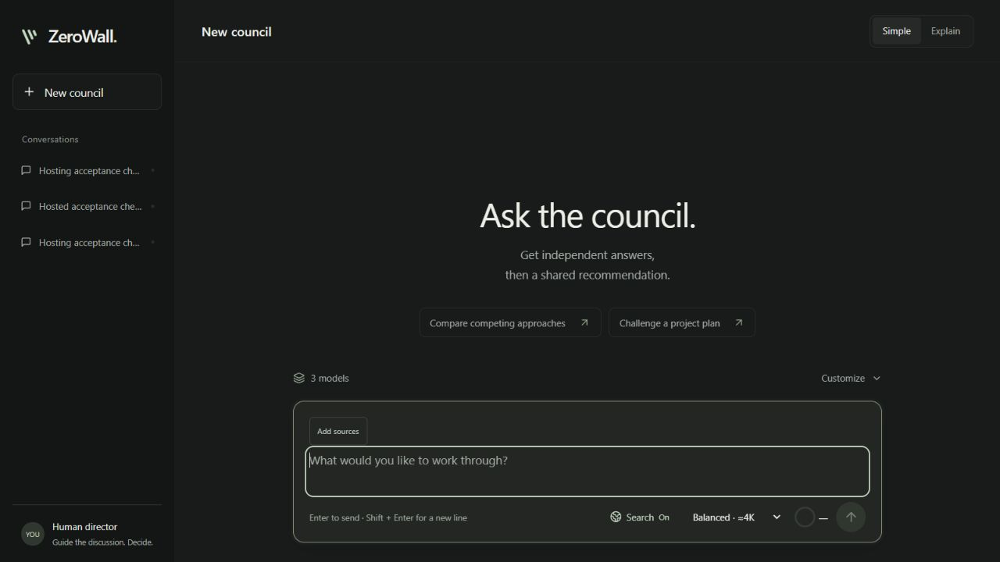
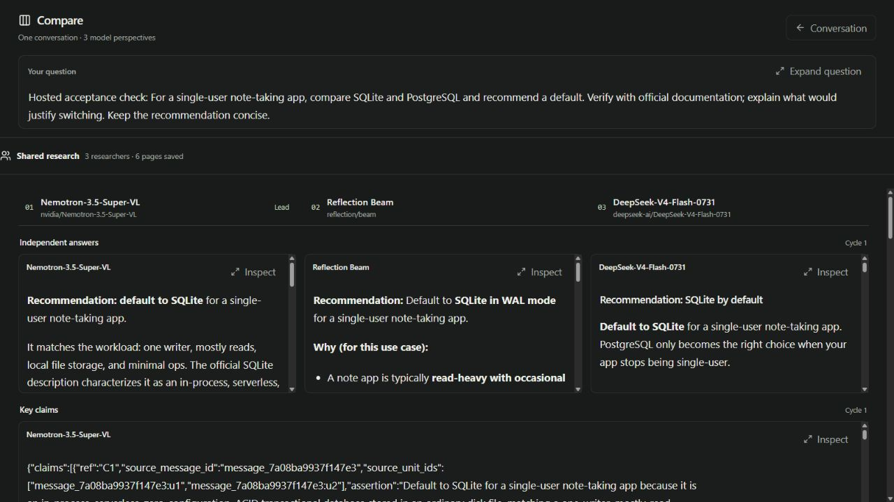
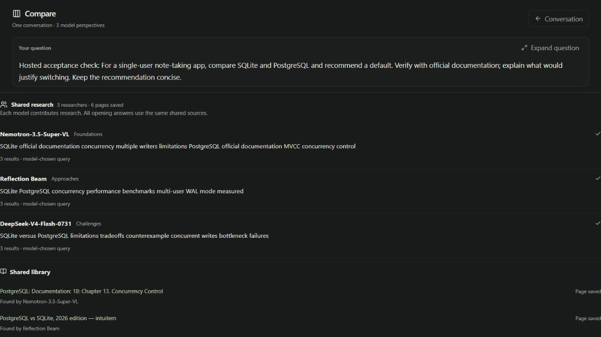
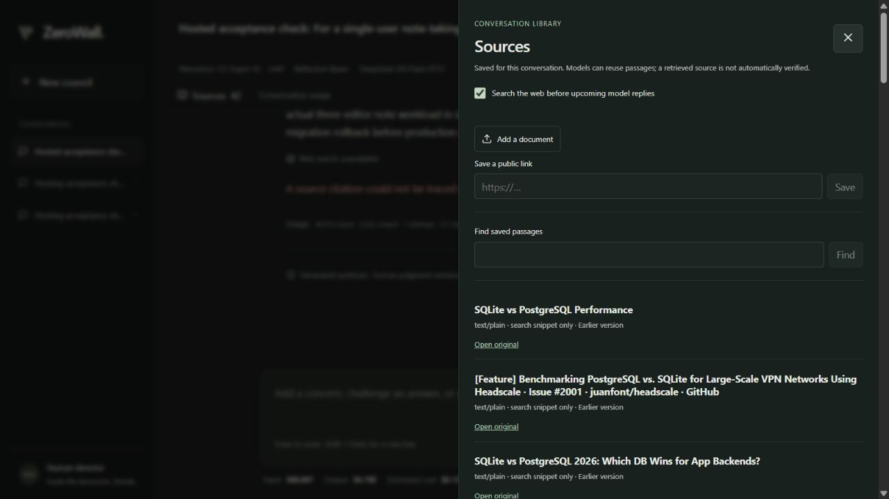

# ZeroWall

A human-directed model council: research together, compare independent answers, follow the debate and review a final synthesis. Shared Tavily search and extracted source passages stay with the conversation.

## Demo and testing

- **[Watch the demo — 2:48](https://youtu.be/IOy6m_5ZwuM)**
- **[Open the hosted council](https://web-mu-weld-26.vercel.app/)**
- **[Testing instructions for judges and invited testers](docs/submission/TESTING.md)**

**The hosted website requires an access code (director token) before you can proceed.** Hackathon judges should use the code supplied privately with the Devpost testing instructions. Invited testers should obtain it from the project owner, [AlphaSudo](https://github.com/AlphaSudo). Enter it in **Access code**, then select **Open council**. The code itself is kept out of this public repository.

Hosted testers need no installation, provider API key, Nebius/Tavily account or payment details. The access code opens a shared judging workspace; it is not a Token Factory API key. [Developer setup](#run-locally) is available below for running your own copy.

**Release freeze:** October 26, 2026. Runtime behavior and model settings are frozen. The video, hosted app and screenshots below show that baseline.

## Gallery

The hosted interface and a saved live SQLite/PostgreSQL demo. Click any image to view it at full size.

| Ask the council | Compare model perspectives |
| :---: | :---: |
| [](docs/images/gallery/01-council-home.jpg) | [](docs/images/gallery/02-compare-models.jpg) |
| Start with one question, optional documents and Search On. | Read independent answers and inspect the council's review flow. |
| **Research together** | **Shared source library** |
| [](docs/images/gallery/03-shared-research.jpg) | [](docs/images/gallery/04-source-library.jpg) |
| Models contribute complementary searches and pool their discoveries. | Reopen sources and distinguish search excerpts from saved page content. |

## Council features

**Current baseline:** NVIDIA Nemotron 3.5 Super VL leads Reflection Beam and DeepSeek V4 Flash 0731 through Nebius Token Factory. Search is on by default; Simple/Explain, Compare, thinking selection and the context indicator are available in the same chat. Lightning is optional and unselected; GLM is retired from the council selector. See the [baseline register](docs/operations/COUNCIL_BASELINE.md).

**Hosted council:** Vercel and Supabase production acceptance passed; see [the hosted results](docs/operations/PRODUCTION_ACCEPTANCE.md) and [judging availability checks](docs/operations/JUDGING_AVAILABILITY.md). Release materials: [release status](docs/submission/RELEASE_READINESS.md), [submission checklist](docs/submission/FINAL_CHECKLIST.md), [project description](docs/submission/PROJECT_DESCRIPTION.md), and [recording script](docs/submission/DEMO_SCRIPT.md). The legacy experiment workflow remains available for existing missions but is not the current product demo.

**Answer-first Council is implemented:** [1.06 release record](docs/releases/COUNCIL_1.06.md), [plan](plans/12_ANSWER_FIRST_COUNCIL_1.06.md) and [checklist](plans/12_ANSWER_FIRST_COUNCIL_1.06_CHECKLIST.md). Public answers save before review; incomplete annotations do not require paid formatting retries or a new chat. New councils use the enhanced baseline. Historical publications retain their original rules, with adoption on an explicit follow-up. See [state and recovery operations](docs/operations/ANSWER_FIRST_COUNCIL_106.md).

**Unified Council workflow (retained from 1.03):** independent answers, targeted challenges, public author responses/revisions, scoped local checks and a final synthesis. The current selected lead is Nemotron Super; historical releases describe their original model assignments. No review-version or mode selector is needed. Same-chat follow-ups preserve history; selected-claim challenges revisit affected reasoning and **Explain this answer** explains a saved result without claiming new checks. See the [historical release record](docs/releases/1.03.md), [implementation checklist](plans/10_UNIFIED_COUNCIL_1.03.md) and [acceptance register](docs/validation/council-1.03-status.json).

The software retains the 1.01/1.02 foundations and reproduces historical publications. Independent semantic quality remains pending. Historical four-provider development runs retain their original partial results and failures. Current local records include completed Token Factory calls for the present lineup; a submission demo must identify its actual run and evidence. Missing monetary usage is unreported, not certified zero. OpenRouter remains disabled. Dark mode and local equation rendering remain the default.


**Sources, research and usage (application 1.5.0):** attach documents before starting and reuse the conversation's Sources library. Supported councils default to **Search On**, with a switch beside the main composer controls. Each enabled model reply receives real search results or an explicit limitation; fresh and cached results are labelled separately. Exact cache/read/write token categories and prices appear where reported; unknown billing stays unknown. Search uses bounded Tavily Basic requests and the same saved source library for all seats. See [per-reply search](docs/operations/PER_REPLY_WEB_SEARCH.md), [the release record](docs/releases/1.05.md) and [implementation checklist](plans/11_RESEARCH_MEMORY_AND_COST_1.05.md).

**Collective web research:** before opening answers, the selected models choose complementary queries concurrently, search through Tavily in parallel, and pool their discoveries. Tavily Extract saves up to six unique pages in one batch. Every opening answer then receives the same frozen library and readable passages. **Shared research** shows each query, overlapping discoveries, contributing models, and saved-page versus excerpt status. Planning uses the existing research allowance and all usage remains counted. See [the collective research workflow and demo](docs/operations/COLLECTIVE_RESEARCH.md).

**Token Factory testing:** the authorized local setup uses the current three-model lineup above. Research/source tools and per-response price cards are connected; model-price verification refreshes read-only and lasts seven days. Conversation input/output totals and costs remain visible. Existing-credit authorization preserves the $24 aggregate cap and $0 additional-payment limit; it does not certify or change provider card-charging settings. See [testing operations](docs/operations/TOKEN_FACTORY_TESTING.md) and [the current baseline](docs/operations/COUNCIL_BASELINE.md).

## Run locally

Prerequisites: Python 3.11+, Node.js 20.19+ or 22.12+, npm, and a browser. No cloud/GPU account is needed for the local demonstration.

Windows PowerShell, from the project directory:

```powershell
.\scripts\setup.ps1
.\.venv\Scripts\python.exe scripts/seed_demo.py
.\.venv\Scripts\zerowall.exe serve
```

In a second terminal:

```powershell
.\.venv\Scripts\zerowall.exe open
```

Open `http://127.0.0.1:8000/` directly to reach the prompt composer; no token entry or terminal command is required. The browser establishes its local session automatically. A temporary connection failure offers **Go to prompt** to retry. Provider API keys stay on the server. Bind to localhost and use exactly one server process per data directory.

For the selected **Vercel + Supabase** cloud route, use the [deployment guide](docs/operations/VERCEL_SUPABASE.md), root `vercel.json` and `deploy/vercel.env.example`. Production uses Postgres, private Storage and one separate council worker; local SQLite remains the default. The cloud has its explicitly authorized fresh $24 allowance, while local paid inference is disabled. The [volume-backed option](docs/operations/HOSTING.md) is also retained.

For dashboard clicks and every required credential/environment variable, follow [account setup](docs/operations/ACCOUNT_SETUP.md). Public source repository: [AlphaSudo/CouncilAI](https://github.com/AlphaSudo/CouncilAI).

Stop the server before running the demo seed or backup command; both take the same exclusive executor lock and refuse an active server.

Cross-platform manual setup:

```text
python -m venv .venv
# Activate .venv using your shell, then:
python -m pip install -r requirements.lock
python -m pip install --no-deps -e .
python scripts/setup_tokenizers.py
npm ci --prefix apps/web
npm run build --prefix apps/web
python scripts/seed_demo.py
zerowall serve
# In another activated terminal:
zerowall open
```

For development, run `npm run dev --prefix apps/web`; Vite proxies `/api` to the backend on port 8000. The packaged UI is served directly by FastAPI after a production build.

Token Factory uses a **262,144-token shared input/output context window**. Setup downloads pinned public tokenizer files (about 61 MB total), with checksum verification; no model weights or GPU are needed. Counting runs locally with an explicit chat-framing allowance. The complete request is checked after sources and tool history are attached. Provider-reported usage remains authoritative; financial reservations continue to use the larger serialized-byte bound at uncached prices inside the $24 cap. See [context-window operations](docs/operations/CONTEXT_WINDOW.md).

## Use council chat

Council opens in **Simple** view: enter a question, read the answer, and expand **Council discussion** when useful. **Customize** holds model selection and answer requirements. Switch to **Explain** at the top to see the complete process, model identifiers, role assignments and execution diagnostics. The view preference stays in your browser; changing it preserves the draft and chat and makes no inference request. See the [design research and specification](docs/design/COUNCIL_INTERFACE.md).

**Compare** opens the same chat as a full-window reading table: the question above aligned model columns, with successive stages and follow-ups below. **Expand question** and **Inspect** open a full response with text zoom, copy and saved usage details. **Conversation** returns to the unchanged draft and reading position. This view makes no inference requests; see [Compare and scrolling](docs/operations/COUNCIL_COMPARE.md).

**Edit & regenerate** revises any sent user message in the same chat, including a failed request. The council starts again from the correction; original replies stay labelled as an earlier version and all previous charges remain counted. The editor keeps your separate composer draft intact. See [Message editing](docs/operations/MESSAGE_EDITING.md).

Use the configured **Token Factory** council, optionally adjust models or answer requirements in Customize, enter a question and press **Start council**. With Search On, the selected models plan complementary queries, search through Tavily and pool sources before independent answers. The council then maps claims, challenges them, lets authors respond and revise, checks the result and synthesizes an answer. A usual three-model cycle plans three research queries plus ten council replies. Conversation usage is cumulative and provider quotas remain separate. Direct-provider adapters are retained for explicitly configured alternatives.

Use **Claims & evidence** to inspect source passages, author revisions, approach families, objections, scoped checks and evidence. **Challenge this claim** starts a targeted follow-up in this chat. Source excerpts can also be supplied in Answer requirements; supplying a source never automatically verifies a claim. Old answers retain their original review status when a new request adopts the current Council. See [the walkthrough](docs/COUNCIL_CHAT.md).

For the current council, save `NEBIUS_API_KEY` and `TAVILY_API_KEY` in ignored `.env.local`; see `.env.example` and [collective research](docs/operations/COLLECTIVE_RESEARCH.md). Live Token Factory use also needs explicit local spending authorization and verified prices; keys alone do not grant spending authority. Optional direct-provider adapters use `ZAI_API_KEY`, `GEMINI_API_KEY`, `NVIDIA_NIM_API_KEY` and `GROQ_API_KEY`, with `ZEROWALL_DIRECT_FREE_CONFIRMED=true` only for confirmed free access. These are not required for the current Token Factory lineup. [Direct-provider operations](docs/operations/DIRECT_PROVIDERS.md) describes those alternatives.

Downloaded review packs reproduce labels without a provider key:

```powershell
.\.venv\Scripts\python.exe scripts/verify_review_pack.py path\to\review.zip
```

Independent quality evaluation uses [the human scoring protocol](docs/evaluation/QUALITY_PROTOCOL.md), a frozen manifest template and `scripts/summarize_review_quality.py`. The summarizer needs no API key and keeps missing labels, failed runs, denominators and unknown cost explicit. It does not judge answers with another model or grant publication authority.

Use the message box to steer the next turn, **Pause / Resume** to control dispatch, or **Synthesize now** to finish early. Accept the final answer or download the Markdown transcript. Model IDs and saved conversations remain visible. **Synthetic demo** uses scripted text and needs no key; it must not be presented as a live Token Factory run. See the [chat walkthrough](docs/COUNCIL_CHAT.md).

## Use the research workflow

The legacy experiment workflow remains available at `/?workspace=research` for existing missions. It is no longer linked from the council. Council web search and its shared source library remain part of the chat.

1. Create a mission with question, deliverable, constraints, sources, rubric, budget and acyclic dependency steps. Review the advanced fields, then freeze it.
2. Start a round. Hardware/Physics, Driver/Runtime, Inference Engine and Model/Algorithms receive role-isolated copies of one hashed context. Four logical seats may reuse one actual model; identities stay visible.
3. Reveal only after all four valid private commitments exist. Cross-examine hypotheses, controls, trade-offs and director concerns.
4. Plan and approve a typed calculation, evidence import/validation, rubric review, bounded API request or controlled benchmark. There is no arbitrary model-written shell execution.
5. Inspect raw evidence, record a reframe, retain dissent and draft a decision. Confirmed findings require every hard gate. You can approve an honest inconclusive report with unknown gates intact.
6. Download the checksummed ZIP and reproduce its deterministic calculations offline.

The four workspaces cover Mission Room, Council Round, Conflict Map, Experiment Board, Evidence, Bottleneck Map, Decision Ledger and Research Report, plus a dependency graph. Concerns invalidate prior approvals and require a fresh current-context round. Reopening a prerequisite marks descendants stale. Pause stops new dispatch; already-dispatched requests may still finish and be billed. Failed/interrupted rounds preserve valid seats and can explicitly continue missing ones.

## Token Factory and the spending boundary

Token Factory remains behind its billing-verification gate. The OpenRouter description below records the historical free-provider path; OpenRouter is disabled and hidden for new councils in the current build. Use the direct-provider workflow above.

For a chat using the saved free key, choose **OpenRouter · free only** above the composer. For the supporting research workflow, choose that provider in the new-mission execution selector. The allowance is fixed at $0, and selected model identities remain visible. Chat allows 20 total attempts per conversation, with at most two automatic retries per turn and three across the conversation. The research workflow retains its 12-attempt limit and explicit continuation policy. Both share the 50-attempt workspace limit per UTC day, and the actual OpenRouter quota is checked separately. A default chat needs ten successful requests; the research workflow's initial four-seat council plus cross-review needs eight. Free API evidence carries its provider label, and its ledger is separate from Token Factory. Token Factory cost/routing benchmarks remain unavailable to free missions.

Free quota does not guarantee provider capacity. Temporary chat errors wait and retry visibly, honoring provider retry hints. Persistent member outages can continue with at least two available models, with missing participation disclosed. Fewer than two stops with an availability explanation; only an explicit director action can request a partial synthesis. Keep-alive traffic cannot extend a free response indefinitely. Paid routes remain disabled. See [reliability findings](docs/validation/free-reliability-findings.md).

Copy `.env.example` to `.env.local` if needed and set `NEBIUS_API_KEY` locally. Never commit a populated credential file. The existing default Token Factory project is sufficient.

The exact enabled priority is:

1. `nvidia/Nemotron-3.5-Super-VL`
2. `zai-org/GLM-5.3-Flash`
3. `nvidia/Nemotron-3_5-Lightning`

Optional `deepseek-ai/DeepSeek-V4.1-Flash` remains disabled. Unlisted IDs are rejected. The research workspace's four role-based seats use the first verified available model in this order. Chat instead requires distinct selected model identities, ordered by this priority. The controlled fast-first benchmark is a separately approved routing treatment, using the last verified enabled model and at most one escalation to the first. An account catalog check verified availability of all three enabled IDs; that check made no inference request.

**Authorization: at most $24 of the reported $25 existing balance; $0 additional personal payment; $0 rented GPU spending.** The provider controls its own card charging and other applications can spend independently. ZeroWall cannot guarantee account-wide protection by itself.

Live dispatch fails closed until the director records current account evidence for existing credit and disabled automatic payments, exact-model prices, and a conservative envelope covering all billed token categories. Use the Provider & Spending Controls dialog or the typed `/api/settings/live-verification` endpoint. Do not assert an unverified prerequisite just to unlock a test. The initial operational cap should be small, below the $24 absolute limit. Verification expires after 24 hours by default.

Every attempt reserves integer micro-dollars before network dispatch. The benchmark reserves its entire maximum schedule first, including potential escalations. Actual usage settles the charge; absent usage, HTTP failures and ambiguous timeouts retain the maximum until reconciliation. A bound breach records the reported charge and locks further dispatch. There are no hidden SDK retries or automatic paid regeneration after restart. Requests use the provider's documented `max_completion_tokens` bound including visible and reasoning tokens; exact account/model billing remains a verification prerequisite. [Official API specification](https://api.tokenfactory.nebius.com/docs)

## Experiments and scientific scope

The OpenRouter integration below is historical documentation. OpenRouter is disabled by default and is not required for the current council. Its old smoke command requires explicitly restoring legacy support. Historical command:

```powershell
.\.venv\Scripts\python.exe scripts/smoke_openrouter.py --report docs/validation/openrouter-smoke.json
```

This uses a new database under `data/openrouter-smoke/`, the bundled public demo sources, and the pinned `nvidia/nemotron-3-super-120b-a12b:free` variant. It exercises four private commits, atomic reveal, four cross-reviews and a numerical tool. The adapter verifies all published prices are zero before every dispatch, sends zero prompt/completion/request price ceilings, passes the council schema through structured output and validates it locally, disables provider fallbacks and reasoning for this integration test, caps attempts at 12 per mission and 50 per UTC day in the workspace, and never retries automatically. A quota error stops the job and records backoff before explicit continuation. Missing cost data or a different model identity locks further calls; any reported nonzero cost is preserved as an anomaly. Nothing in this command authorizes paid models, tops up an account, unlocks Nebius, or runs the controlled benchmark. [OpenRouter routing controls](https://openrouter.ai/docs/guides/routing/provider-selection), [reasoning token limits](https://openrouter.ai/docs/guides/best-practices/reasoning-tokens), [structured outputs](https://openrouter.ai/docs/guides/features/structured-outputs).

The successful eight-call run reported zero cost for every call. Earlier Super VL tests exposed output-token exhaustion, incomplete JSON fields, and an upstream structured-output error; those traces are retained. You can explicitly select that free variant with `--model nvidia/nemotron-3.5-super-vl:free`, but there is no automatic model fallback. The app's ordered Nebius model policy is unchanged. See [live-test findings](docs/validation/openrouter-live-check.md).

The sanitized summary is shareable; raw responses remain local and ignored. A successful test establishes model/API integration with OpenRouter. Token Factory acceptance and research cost/quality claims require their own evidence. Free quotas and model availability are controlled by OpenRouter.

The authored benchmark contains four exploration tasks and eight held-out confirmation tasks. The model-visible source packets and the hidden numerical/factual keys are separate files. Packing removes exact duplicate facts and boilerplate while retaining source IDs, required facts, constraints and the output contract. Routing sees only visible schema/source-presence checks; hidden answers never determine escalation.

The four cells are full context + fixed strong model (C00), packed context + the same model (C10), full context + explicitly approved fast-first routing (C01), and packed context + the same routing (C11). Task blocks are seeded and their within-task order is counterbalanced. Confirmation requires the same recorded strategy as exploration. Reports retain invalid tasks, failures, escalation cost, missing usage and incomplete blocks.

Analysis provides cost per valid task, complete workflow latency, paired effects, task-level bootstrap intervals when at least eight independent tasks are available, an exploratory log-cost interaction and feasible Pareto candidates. No valid task means an undefined cost ratio. The hidden validators check this authored task set; source-ID coverage and frozen fact terms are not general semantic entailment. Human quality review must identify the actual reviewed evidence and is a separate gate.

Confirmation requires the lower bootstrap saving bound to meet the frozen materiality threshold and human quality review of the actual confirmation evidence. Once a mission consumes its held-out schedule, additional tuning/confirmation is refused. New council contexts carry prior revealed hypotheses, evidence, reframes and decision memory while keeping current-round private answers isolated.

Evidence labels distinguish measured API, calculated, imported, inferred, untested and fixtures. Non-streaming requests have **unknown TTFT**. Client API latency does not measure provider memory bandwidth, kernels, power or scheduling. A small pilot cannot prove broad council superiority. Free hardware work is an optional later protocol in `plans/optional/`.

## Validate and reproduce

```powershell
.\.venv\Scripts\python.exe -m pytest -q
npm run build --prefix apps/web
Push-Location apps/web
npx playwright test
Pop-Location
.\.venv\Scripts\python.exe scripts/doctor.py
.\.venv\Scripts\python.exe scripts/verify_pack.py path/to/pack.zip
.\.venv\Scripts\python.exe scripts/reproduce.py path/to/pack.zip
```

The browser suite uses installed Microsoft Edge on Windows, a separate data directory and port 8001, with the provider key explicitly absent. For other platforms set Playwright's channel to an installed browser or install its free Chromium browser. It creates a fixture mission and performs a real local numerical experiment. No API key is needed. Offline reproduction re-runs registered calculations/comparisons from stored inputs, rather than generating new model output.

`contracts/` contains exported Pydantic JSON Schemas. Regenerate with `python scripts/export_contracts.py`. API docs are at `/api/docs` and the OpenAPI schema at `/api/openapi.json`. Every control request needs director authentication, the director header, an idempotency key, and the relevant expected revision; the UI supplies these.

## Data, backup and distribution

SQLite, private commitments, artifacts, local auth token and exports live under ignored `data/`. Treat that directory as private. Stop the server before a consistent backup:

```powershell
.\.venv\Scripts\python.exe scripts/backup.py create backup.zip
.\.venv\Scripts\python.exe scripts/backup.py restore backup.zip --destination data-restored
$env:ZEROWALL_DATA_DIR = (Resolve-Path data-restored)
.\.venv\Scripts\zerowall.exe serve
```

Restore verifies every file, generates a new local director token at startup and clears live billing authorization. It preserves reservations; restart marks unresolved dispatched attempts unknown. Never automatically replay an interrupted paid operation.

`python scripts/package_release.py` optionally creates a source/test-build ZIP with a built UI and checksums and checks for configured credentials. Inspect any archive for private working evidence before publishing it. Public source is available at [AlphaSudo/CouncilAI](https://github.com/AlphaSudo/CouncilAI); the hosted application and [demo video](https://youtu.be/IOy6m_5ZwuM) are the submitted-project entry points. A separate downloadable build is optional for this hosted route. The entrant still needs to complete the Devpost form and supply the access code privately. Preserve the judged snapshot and access instructions through December 15, 2026.

## Architecture and implementation evidence

`src/zerowall/` contains contracts, SQLite state/audit/queue, governance, budget, provider, executor, benchmark, deterministic analysis and reports. `apps/web/` is React/TypeScript/Vite. `scripts/` contains setup, diagnosis, demo seeding, pack verification/reproduction, backup/restore, schema export and release packaging. Tests cover privacy, governance, numerical checks, financial boundaries and recovery.

The blueprint and versioned implementation requirements are in `plans/`. Current acceptance evidence and honest release-gate status are in `docs/IMPLEMENTATION_STATUS.md`. The MIT license covers the application; authored synthetic tasks are CC0. Provider/model terms apply separately. See `THIRD_PARTY_NOTICES.md` and `docs/submission/`.
