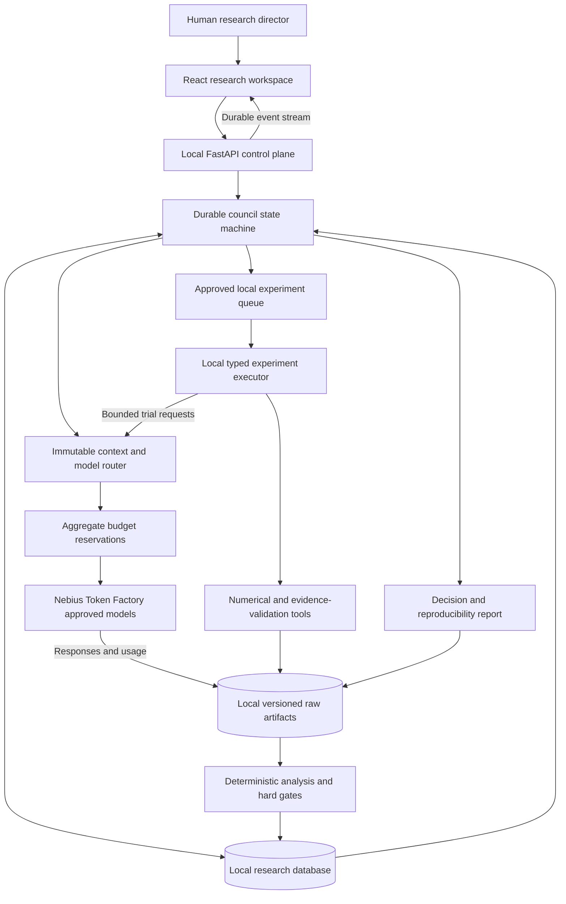
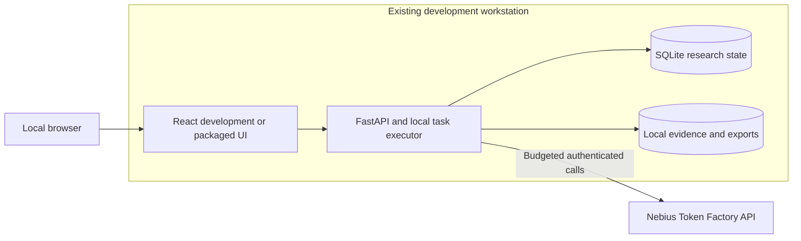
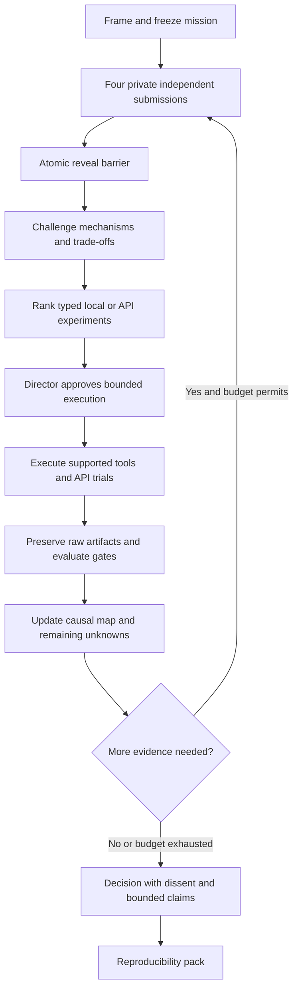
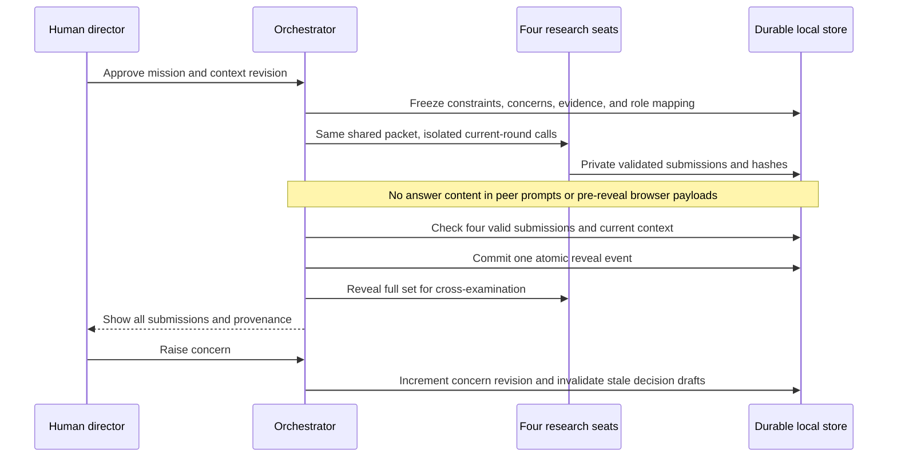
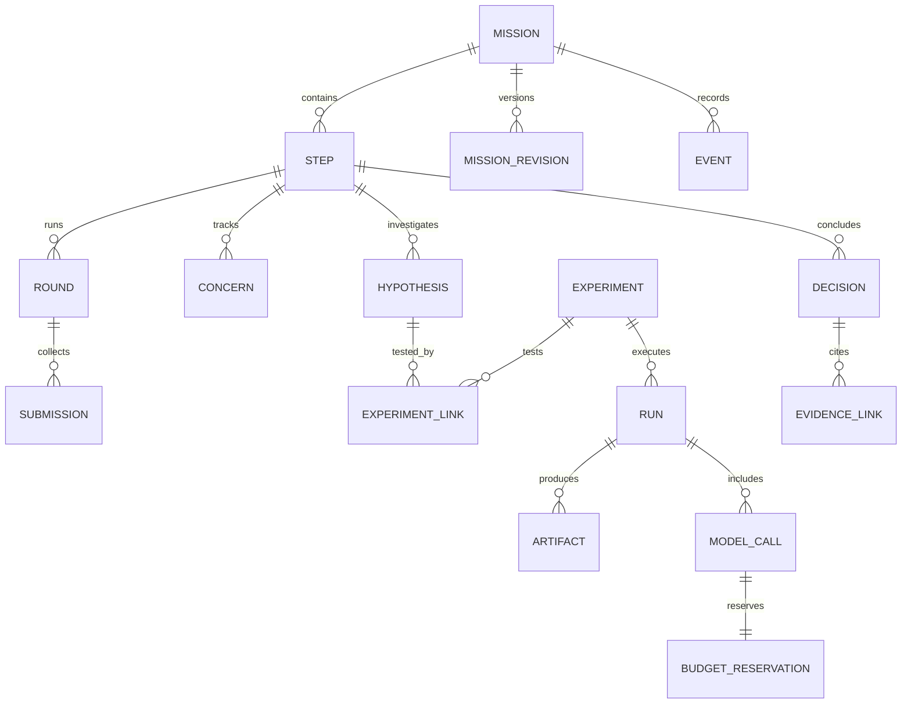
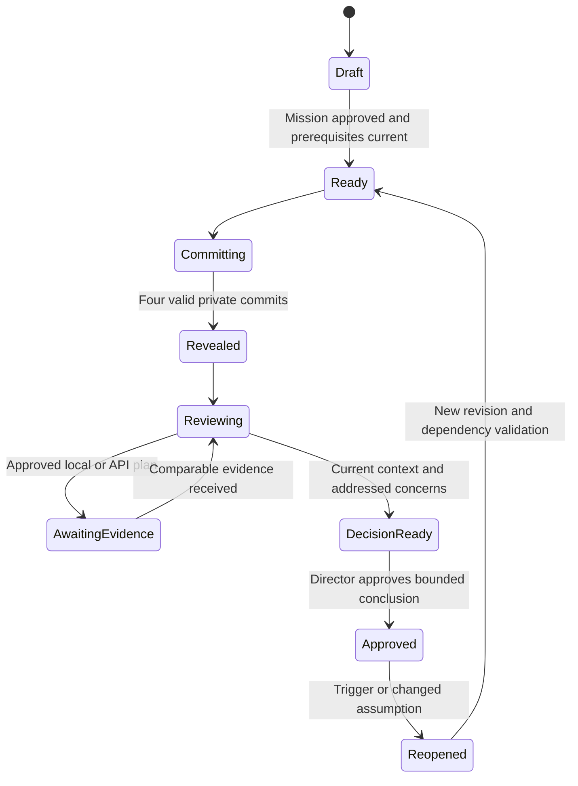

# ZeroWall Blueprint and Roadmap

**Current architecture, October 18:** local application and tools, with all required model inference through Nebius Token Factory. No self-managed GPU or AI Cloud resource is required. [Budget authority](05_BUDGET_AND_ACCESS.md) caps existing-credit use at $25 and additional personal payments at $0.

[System blueprint drawing](diagrams/zerowall-blueprint.svg)  
[Release roadmap drawing](diagrams/zerowall-roadmap.svg)

## 1. Product and execution boundary

ZeroWall coordinates an inspectable research process. A mission contains governed research steps, independent council rounds, concerns, hypotheses, typed experiments, evidence, and director-approved decisions. Four researchers can reason across the full AI stack; each claim must state what is observed, calculated, imported, inferred, or untested.

The mandatory evidence mission evaluates a hosted research workflow using supported request/context/model-routing choices and local deterministic validators. It measures client-visible results and does not claim control of the provider's inference engine or hardware.

Core execution requires a browser, the existing workstation, local application dependencies, and a Token Factory key. It requires no model weights, local inference server, GPU driver changes, cloud IAM key, SSH key, paid database, or cloud artifact bucket.

The [optional memory-wall experiment](optional/04_MEMORY_WALL_GPU_PROTOCOL.md) is a later extension. Its absence does not block versions 0.1-1.00.

## 2. System blueprint



The local task executor is an application process or background task, not a rented machine. All inference, including experiment calls and retries, passes through the same budget-controlled router. Local numerical tools do not need a model call unless a separately approved plan requests one.

## 3. Deployment drawing



SQLite is the initial local database. Use transactional revisions, audit events, and a single active local executor. PostgreSQL can be a later deployment choice; its availability is not a core prerequisite. Keep artifacts on disk with hashes and a portable export layout.

Bind the development backend to localhost. Public/demo access is a release decision requiring appropriate authentication and strict account-wide spending controls; do not expose an unlimited endpoint backed by the credit balance.

## 4. Scientific workflow drawing



Each loop compares observations with predictions. A budget-exhausted investigation can end inconclusively. The council never needs to agree unanimously before recording a valid decision with dissent.

### 4.1 Commit-Reveal sequence



A hash records content integrity; it is not a zero-knowledge commitment. Private submissions are hidden from peer calls and browser endpoints before reveal, not from the trusted local administrator.

## 5. Council roles and actual models

| Seat | Research responsibility | Scope limitation |
| --- | --- | --- |
| Hardware and Physics | Challenge theoretical limits, resource assumptions, analytical bounds, and alternative mechanisms. | No claim of newly measured hardware behavior without corresponding evidence. |
| Driver and Runtime | Examine application scheduling, transfers/context movement, concurrency, and overhead hypotheses. | Hosted backend runtime internals remain unobserved unless documented or supplied as external evidence. |
| Inference Engine | Assess endpoint behavior, latency definitions, request validity, supported options, and engine hypotheses. | Supported API arguments do not imply access to kernel or scheduler configuration. |
| Model and Algorithms | Investigate model selection, context strategy, task decomposition, output quality, and route trade-offs. | Routing benefits need measured task-quality and cost evidence. |
| Human director | Freeze success criteria, concerns, budgets, permissions, and final decisions. | Cannot relabel failed/unknown hard gates as passed. |
| Non-voting orchestrator | Context, phase transitions, queue, ledger, audit, retry, and stopping. | No independent scientific vote. |

Keep seat identity separate from actual model ID. The [director's model order](06_MODEL_SELECTION.md) is authoritative: Super VL, GLM 5.3 Flash, then Lightning; optional DeepSeek is disabled. Preserve exact IDs and do not automatically substitute unlisted models. Four seats may reuse one or more models with separate role instructions, and every call still requires a verified budget reservation. Do not label that arrangement as four independent model families.

The Token Factory adapter starts from `https://api.tokenfactory.nebius.com/v1/` and stores the actual endpoint/model/capability manifest. Probe only supported features after billing verification. Native tool-calling support is optional because typed local dispatch can enforce the tool contract itself. [Token Factory quickstart](https://docs.tokenfactory.nebius.com/quickstart)

Expose concise mechanisms, predictions, evidence references, revisions, and recommendations rather than private chain-of-thought. Model confidence statements are not statistical probabilities.

## 6. Local modules

| Module | Owns | Boundary |
| --- | --- | --- |
| Mission service | Goals, deliverables, envelope, rubric, gate versions, step graph, and budget. | No invented observations. |
| Context builder | Immutable mission/dependency/concern/evidence snapshots and context packing. | Never omit hard constraints silently. |
| Council orchestrator | Four-seat barrier, cross-review, decision drafts, stopping, and reopening. | No gate bypass through consensus. |
| Model router | Token Factory calls, model identity, capability checks, retry, and usage. | Every attempt requires a budget reservation. |
| Budget service | Persistent reservations, estimated/actual spend, unknown charges, and cutoff. | Fail closed if maximum request cost cannot be bounded. |
| Research memory | Hypotheses, assumptions, trade-offs, dissent, and negative results. | A summary is not raw evidence. |
| Experiment planner | Falsifiable typed plans and disclosed priority scores. | No arbitrary executable model text. |
| Local executor | Approved API trials, registered calculations, parsers, and validators. | No provisioning, unrestricted shell, or unapproved network requests. |
| Analyzer | Deterministic metrics, rubric results, paired effects, and verdicts. | Missing measurements stay unknown. |
| Report service | Fixed-revision JSON, Markdown, HTML, and portable evidence pack. | Cannot upgrade an inconclusive claim. |

### 6.1 Allowed capabilities

```text
inference.validate_request
inference.run_trial
evidence.import
evidence.validate
analysis.calculate_bound
analysis.compare_trials
analysis.evaluate_rubric
artifacts.package
```

Each capability maps validated arguments to a registered local implementation. Fix allowed input/output paths, size/time limits, model IDs, request limits, and cost reservation. An analytical model must identify its assumptions and label its result calculated, rather than measured.

For optional extension X1, the app may export a notebook experiment plan and import its measurements. That does not create a mandatory remote worker or account dependency.

## 7. Contracts and persistence

| Contract | Required content |
| --- | --- |
| MissionBrief | Goal, deliverable, step graph, evidence packet, workload/task manifest, objective, rubric, hard gates, budget, approval, revision. |
| ContextSnapshot | Mission/step/dependency revisions, concern revision, evidence hashes, role mapping, prompt/packing version, token estimate. |
| ResearchSubmission | Seat/model/context IDs, mechanism, falsifiable predictions, experiment idea, affected layers, kill rule, uncertainty. |
| CrossReview | Challenged hypothesis IDs, missing controls, trade-offs, evidence needed, concern responses, revised recommendation. |
| TradeoffCard | Expected/observed pros and cons, hidden costs, mitigations, operating region, complexity, rejection rule. |
| ExperimentPlan | Hypothesis IDs, capability, treatment/control, task/config/model hashes, repeat/order schedule, validators, limits, approval. |
| BudgetReservation | Call/attempt ID, verified price revision, bounded input/output allowance, maximum reserved cost, settlement state. |
| EvidenceManifest | Run/attempt IDs, timestamps, raw response/artifact hashes, task/request/model/endpoint provenance, collection coverage. |
| GateResult | Rule, measurement, threshold, method/version, evidence IDs, pass/fail/unknown/invalid. |
| DecisionRecord | Alternatives, reasons, evidence, dissent, assumptions, concern dispositions, director action, reopen triggers. |

All contracts have immutable IDs, UTC timestamps, and schema versions. A free-text answer alone cannot satisfy a typed hypothesis, experiment, or final finding.

### 7.1 Data relationships



Additional tables include step dependencies, assumptions, causal nodes/edges, bottleneck observations, local jobs/attempts, and exports. Negative-results memory is a query/view over rejected or falsified hypotheses and evidence, not a second inconsistent copy.

### 7.2 Atomicity rules

- State transitions and audit events commit in the same transaction.
- Reveal requires all four submissions for the current context and concern revision.
- Approvals require expected record revisions; stale browser tabs cannot overwrite decisions.
- Request-cost reservation is committed before network dispatch; concurrent calls cannot reserve the same remaining dollars.
- Unknown/timed-out charges keep their reservation until reconciled.
- One local executor owns an active job; restart recovery reconciles attempts before retry.
- Each attempt has a new artifact namespace; late results never overwrite another attempt.
- Reports freeze a mission revision and checksum their included evidence.

### 7.3 Artifact layout

```text
missions/<mission-id>/
  mission/<revision>/mission.json
  rounds/<round-id>/{context,revealed-submissions}.json
  experiments/<experiment-id>/plan.json
  runs/<run-id>/<attempt-id>/
    task-manifest.json
    request-manifest.json
    raw-response.json
    raw-events.jsonl
    usage.json
    budget-settlement.json
    validator-results.json
    metrics.json
    gate-results.json
    manifest.json
  reports/<report-id>/
    report.md
    report.html
    research-map.json
    hypothesis-registry.json
    decision-ledger.json
    concern-register.json
    assumption-register.json
    minority-report.md
    negative-results.json
    next-actions.json
    reproduce.yaml
    checksums.sha256
```

Do not export keys, auth headers, private account details, or pre-reveal answers in public events. Raw output is untrusted content and must be escaped in rendered reports.

## 8. State and authority



Paused, blocked, cancelled, budget-exhausted, and provider-wait states preserve their prior phase. Operational failure and scientific rejection are different concepts.

| Dimension | Values |
| --- | --- |
| Agreement | Strong consensus; conditional consensus; majority with dissent; unresolved. |
| Hypothesis | Proposed; testing; supported; falsified; blocked; superseded. |
| Candidate verdict | Confirmed within the task/envelope; rejected; inconclusive; invalid comparison. |
| Gate | Pass; fail; unknown; invalid. |
| Director action | Approve experiment; approve finding; request revision; accept a non-hard-gate risk; pause; reopen; cancel. |

A new concern increments its revision and invalidates affected decision drafts. Existing calls can finish, with their charges/evidence retained, but cannot authorize stale approval. Reopening a prerequisite marks dependent steps stale while preserving history.

## 9. API and UI

| API family | Behavior |
| --- | --- |
| `POST /missions`, `PATCH /missions/{id}/draft`, `/freeze` | Create/revise/freeze mission and budget contracts. |
| `GET /missions/{id}` and `/steps` | Current state and dependency graph. |
| `POST /steps/{id}/rounds`, `POST /rounds/{id}/reveal` | Independent round and atomic reveal. |
| `POST /steps/{id}/concerns`, `/pause`, `/resume`, `/reopen` | Director interventions and revision checks. |
| `POST /experiments/{id}/approve`, `/cancel` | Bound execution scope and stop new dispatch. |
| `GET /experiments/{id}/runs`, `/evidence` | Status, raw artifacts, and analysis. |
| `GET /missions/{id}/budget` | Settled/reserved/unknown usage and effective remaining allowance. |
| `POST /decisions/{id}/approve` | Check concerns, dependency revisions, and deterministic gates. |
| `GET /missions/{id}/events?after=<sequence>` | Durable event stream with reconnect. |
| `POST /missions/{id}/exports` | Fixed-revision report and reproducibility pack. |

Modifying endpoints require director authentication, typed validation, optimistic revision checks, and idempotency where retries could duplicate work. Pre-reveal endpoints expose seat status, identity, elapsed time, and sanitized failures only.

| Workspace | Vision views | Main action |
| --- | --- | --- |
| Mission | Mission Room and step graph. | Freeze goal, deliverable, constraints, rubric, and budget. |
| Council | Council Round, Diversity/Conflict Map, concerns. | Reveal, challenge, refresh independent views, pause, or raise concern. |
| Experiments | Experiment Board, Evidence View, Bottleneck Map. | Approve a bounded plan and inspect measured/calculated/imported evidence. |
| Findings | Decision Ledger, Breakthrough Report, exports. | Inspect dissent, approve a bounded result, or reproduce analysis. |

Show mission/context revision, actual model IDs, budget reservations, live/replay/fixture mode, and unresolved concerns persistently. Bottleneck maps distinguish measured application/API effects from unverified backend explanations. Do not convert client API latency into physical memory bandwidth or energy figures.

## 10. Release roadmap

```mermaid
flowchart LR
    V1[0.1 Credit and API feasibility]
    V2[0.2 Local persistence and budget]
    V3[0.3 Commit-Reveal]
    V4[0.4 Review and governance]
    V5[0.5 Hypotheses and experiment plans]
    V6[0.6 Local tools and API trials]
    V7[0.7 Evidence and reframe]
    V8[0.8 UI and reports]
    V9[0.9 Reproduction and test build]
    V10[1.00 Release and submit]
    X1[Optional later free-GPU experiment]
    V1 --> V2 --> V3 --> V4 --> V5 --> V6 --> V7 --> V8 --> V9 --> V10
    V10 -.-> X1
```



X1 can be investigated after the core works if time permits, but no version waits for it. The detailed dates and task lists are in the masterplan and implementation plan.

| Version | Exit evidence |
| --- | --- |
| 0.1 | Credit controls reviewed, affordable model capability verified, mission and trial protocol frozen. |
| 0.2 | Mission/budget survive restart; real model call traceable; local shell works. |
| 0.3 | Four real independent answers reveal together without early access. |
| 0.4 | Concern propagation, dissent, stale approval prevention, and dependency reopening work. |
| 0.5 | Falsifiable hypotheses become capability-valid experiment plans. |
| 0.6 | Approved local/API execution creates complete raw artifacts with bounded spend. |
| 0.7 | Deterministic evidence changes research interpretation or next action. |
| 0.8 | All eight views and required research exports are usable. |
| 0.9 | Clean setup, offline reproduction, budget/recovery checks, and working test build. |
| 1.00 | Public licensed repository, short working video, description, feedback, and submission. |

## 11. Failure behavior

| Failure | Response |
| --- | --- |
| Seat times out | Preserve attempt and reservation; bounded retry or block reveal. Never fabricate a seat's response. |
| Invalid JSON | Preserve raw output, allow one separately reserved repair attempt, otherwise mark invalid. |
| Rate limit | Respect bounded backoff and record every attempt; no hidden retry spend. |
| New concern during generation | Keep results, mark context stale, require responses to the current concern revision. |
| Cost cannot be bounded | Refuse dispatch and keep the plan blocked. |
| Ambiguous timeout charge | Keep the maximum reservation until provider reconciliation. |
| Budget depleted | Stop new requests; preserve evidence and produce a bounded/inconclusive report. |
| Local executor restarts | Reconcile pending attempts before retry; never double-dispatch automatically. |
| Provider model changes | Record actual version/metadata; separate incompatible runs and narrow the claim. |
| Free GPU extension unavailable | Core remains unaffected; optional experiment stays unstarted. |

## 12. Repository structure and decisions

The original module sketch below maps to the implemented Python modules in `src/zerowall/`. See the README and current implementation status for actual files, acceptance evidence and remaining live/external gates:

```text
README.md
LICENSE
pyproject.toml
requirements.lock
.env.example
apps/web/src/{api,components,features,routes,types}/
src/zerowall/
  api/ auth/ config/ db/
  missions/ council/ models/ budget/ memory/
  experiments/ tools/ evidence/ analysis/ reports/
contracts/{mission,council,experiment,evidence,decision,budget}/
prompts/{hardware,runtime,engine,algorithm,review,synthesis}/
benchmark/{tasks,configs,evaluators,protocols}/
scripts/{doctor,seed_demo,reproduce,verify_pack}.py
tests/{unit,integration,protocol,budget,tools,e2e}/
docs/{architecture,research,operations,releases,submission}/
plans/
```

Use Python/FastAPI for the control plane and deterministic tools, SQLite plus append-only audit events for local persistence, React/TypeScript/Vite for the interface, and a database-backed local queue. A model orchestration framework is optional if it preserves the protocol; LangSmith, Tavily, and external human-evaluation services are not prerequisites.

Do not install a local inference stack or create cloud infrastructure as part of normal setup. The only required external runtime service is Token Factory.
