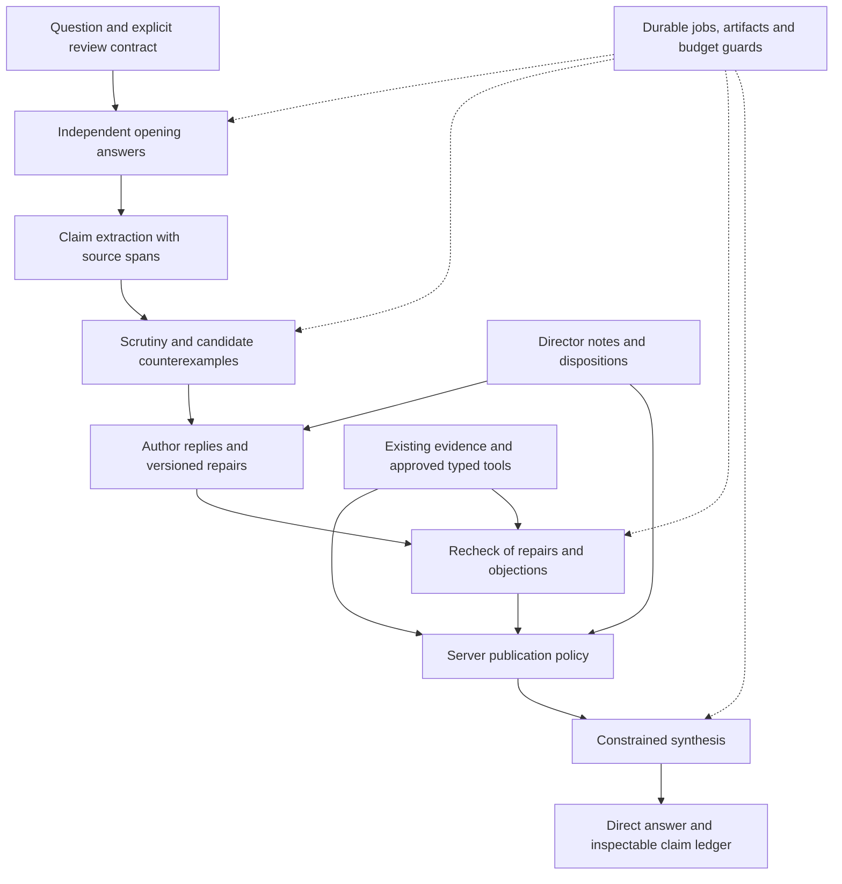

# ZeroWall 1.01: Generic council scrutiny and evidence plan

Updated October 19, 2026. Status: **software implemented; independent quality evaluation pending**. Checked items link to the release and acceptance evidence; unchecked quality/external gates remain pending. See [the 1.01 release](../docs/releases/1.01.md) and [acceptance status](../docs/validation/review-1.01-status.json).

This is an additive extension to the [0.1-1.00 implementation plan](02_IMPLEMENTATION_PLAN.md). It addresses the gap between a visible discussion and an inspectable answer: important claims should carry their scope, objections, revisions, evidence, and unresolved questions into the final response. It preserves generic prompt-driven council chat before any specialization.

Read [the review decisions](../docs/reviews/COUNCIL_REVIEW_1.01.md) for what was accepted, adapted, deferred, or rejected. Existing release, Token Factory, and hackathon acceptance gates remain as recorded; this plan does not mark them complete.

The subsequent [1.02 increment](08_IMPLEMENTATION_PLAN_1.02.md) implements opt-in software for scoped recheck, separate evidence/risk states and atomic assertions. Live final compliance and independent quality remain pending. It does not retrospectively change these 1.01 results or complete their pending quality gates.

## October 19 implementation amendments

- The director replaced OpenRouter with Z.ai, Gemini, NVIDIA NIM and Groq accounts and confirmed free access. OpenRouter is disabled for new inference; its history remains readable. No Token Factory billing lock or spending authority was changed.
- The four-seat reviewed profile has four openings, extraction, scrutiny, four author replies, recheck and synthesis: twelve planned calls plus three shared retry attempts. Three and two seats retain ten and eight planned calls. Direct-provider safety limits are twenty attempts per conversation and one hundred per UTC day per application database; upstream quotas remain separate.
- Extraction selects server-numbered verbatim source passages rather than copying Markdown. Model-facing context uses logical claim IDs without competing database revision IDs. Repairs may be longer than initial source passages while remaining bounded.
- Unresolved proposals can appear in an explicitly qualified conditional recommendation; recorded defects remain excluded from positive recommendations. Server-rendered labels remain authoritative and model prose remains fallible.
- The eighteen authored cases establish protocol invariants. They are not independent human semantic labels. Genuine direct-provider workflow evidence, failed attempts and invoice-cost visibility limits are recorded separately.

## 1. Intended user experience

The director enters a question as today and chooses **Discussion** or **Reviewed council**. Reviewed council presents this visible sequence:

1. Each selected model answers independently.
2. The council identifies the material claims in those answers, with links back to the originals.
3. A scrutiny turn challenges assumptions, evidence, constraints, resources, and failure cases where applicable.
4. Each original author responds to the actual objections, repairs its answer, narrows a claim, or withdraws it.
5. A recheck assesses the revised claims and outstanding objections.
6. The application assembles evidence and publication labels; the final model gives a direct answer using those labels.

The conversation stays the primary interface. A claim drawer provides detail without requiring a second dashboard or a long intake form. The final answer distinguishes supported observations, conditional proposals, unresolved disagreements, withdrawals, contradictions, and useful next tests. It can honestly conclude that no proposal has adequate support yet.

The goal is better answer quality and clearer accountability. A longer transcript, more criticism, a completed pipeline, or several models agreeing is not itself success.

### Boundaries

- Generic tasks include software choices, project planning, numerical reasoning, document analysis, and open-ended research proposals.
- Domain-specific laws, physics ledgers, laboratory protocols, GPU measurements, and memory-wall profiles are later extensions.
- No new paid service, credential, GPU, hosted model, agent framework, or database is required.
- Existing chats keep their protocol; no saved transcript is retrospectively called reviewed.
- All new UI, prompts, help, reports, fixtures, and developer documentation are English.

## 2. Repository baseline and reuse

| Existing component | Reuse | Required 1.01 change |
| --- | --- | --- |
| `council_chat.py` | Independent openings, frozen protocol, messages, controls, provider identities, recovery, partial synthesis. | Versioned reviewed schedule and claim-linked turn context. Keep the existing discussion schedule intact. |
| `contracts.py` | Strict Pydantic contracts; mission, concern, experiment, and revision patterns. | Add separate generic chat-review contracts. Avoid importing workbench-only scientific seats or benchmark requirements. |
| `service.py`, `analysis.py` | Evidence integrity, human concerns, typed experiment authority, scoped deterministic calculations and decision gates. | Reuse evidence references and authority through narrow adapters. Add generic publication policy separately; current API performance gates do not validate arbitrary chat claims. |
| `db.py`, `artifacts.py` | Transactional SQLite records/events/jobs, revision checks, canonical hashes, raw artifacts and redaction. | Add record kinds and explicit versions using the existing store. Add a database migration only if an actual index or schema need is demonstrated. |
| `executor.py`, `free_errors.py` | Durable scheduling, cancellation, retries and ambiguity handling. | Every review phase must obey the same dispatch and recovery rules. |
| `free_provider.py`, `free_limits.py`, `budget.py` | Exact models, zero-price guards, quota checks, request caps, settlement and billing locks. | Account for all planned review calls before dispatch; never bypass guards for a reviewer or recheck. |
| `CouncilChat.tsx`, chat CSS and web types | Prompt entry, transcript, model labels, controls, mobile layout. | Add mode selection, phase cards, claim inspection, and honest final labels. |
| `reports.py` and transcript download | Escaping, snapshot exports and checksummed research packs. | Export the chat review ledger and rebuild its labels offline. |

Existing message/context hashes establish provenance, not truth. Existing research evidence classes remain intact; any generic chat representation must map to them without relabelling fixtures, imports, or calculations as new measurements.

## 3. Blueprint and bounded execution

Models propose content and assessments. The server validates structure, references, freshness, provenance, and publication permissions. It does not become a universal reasoning engine. Typed tool results support only the task, inputs, method, and scope they actually checked.

### Planned profiles

The implemented reviewed mode supports two to four distinct selected models and one scrutiny/repair cycle. The director explicitly requested four provider seats on October 19; this supersedes the original two/three-seat limit. Ordinary discussion retains its existing participant and round controls.

| Phase | Four-model profile | Three-model profile | Two-model profile | Responsibility |
| --- | ---: | ---: | ---: | --- |
| Independent answers | 4 | 3 | 2 | One per selected model; no peer content. |
| Claim extraction | 1 | 1 | 1 | Select attributed source units. |
| Scrutiny | 1 | 1 | 1 | Applicable checks and candidate counterexamples. |
| Author replies and repairs | 4 | 3 | 2 | One per original author. |
| Recheck | 1 | 1 | 1 | Assess revisions and remaining objections. |
| Publication policy | 0 | 0 | 0 | Local evaluation of trusted records. |
| Synthesis | 1 | 1 | 1 | Direct answer with computed labels. |
| **Planned calls** | **12** | **10** | **8** | `2N + 4`, before failures. |
| Shared automatic retry reserve | 3 | 3 | 3 | Existing total allowance, not per phase. |
| **Required start allowance** | **15** | **13** | **11** | Within the twenty-attempt conversation ceiling. |

The current default discussion also plans ten successful calls for three models and two discussion rounds. The new profile reallocates that work; it does not add ten calls on top of the current schedule. The smaller existing two-model/one-round discussion still costs five planned calls and remains a separate option.

The reviewed start preflight checks the selected adapter's known quota/allowance and existing locks. Actual direct-provider quotas can remain unknown; the local cap is not an availability promise. Shared daily capacity can change after preflight; recheck before every dispatch. The earlier OpenRouter snapshot is historical and does not describe the four direct accounts requested on October 19. No inference is needed to implement or test the offline workflow.

Freeze a visible phase-to-model assignment at creation. For example, extraction uses member 1, scrutiny member 2, recheck member 3, and synthesis member 1. In a two-model council recheck may reuse member 1. Each model also authors and repairs its own proposal. This is separation of functions, not independent external review: a shared model may assess its own earlier claim. Disclose that limitation and never add an unselected model to manufacture apparent independence.

## 4. Requirements and acceptance evidence

The software requirements have implementation and test evidence in the linked 1.01 status record. Independent semantic quality evaluation remains pending under R101-13. A checked implementation task does not establish better reasoning or external release acceptance.

| ID | Requirement | Work package | Acceptance evidence |
| --- | --- | --- | --- |
| R101-01 | Keep prompt-first generic chat and preserve older protocols. | 0, 1, 6 | Old/new snapshot and browser compatibility cases. |
| R101-02 | Freeze explicit task constraints, review policy, roles and limits. | 1, 3 | Hash, revision, and constraint-change rejection tests. |
| R101-03 | Preserve opening isolation and actual identities. | 3 | Captured prompts contain no peer content in any opening. |
| R101-04 | Store attributed, scoped and versioned claims. | 1, 2 | Exact span checks, dependency checks and provenance reconstruction. |
| R101-05 | Keep criticism distinct from authority and require concrete targets. | 2, 4 | Wrong-critic, invented-reference and unsupported-veto cases. |
| R101-06 | Preserve repairs, withdrawals and goal changes honestly. | 2, 3, 4 | Revision history, drift, stale evidence and recheck cases. |
| R101-07 | Compute narrow publication permissions from evidence and policy. | 2, 4 | Deterministic replay, unknown/fail/non-applicable and dependency cases. |
| R101-08 | Constrain synthesis and retain unresolved/minority views. | 4, 6 | Referenced output validation, fallback and human quality review. |
| R101-09 | Preserve material constraints and objections in bounded context. | 3, 4 | Long-history and overflow tests with required-context assertions. |
| R101-10 | Respect all cost, quota, retry, cancellation and recovery rules. | 3, 5 | Every-phase failure injection and attempt-ledger reconciliation. |
| R101-11 | Use only authorized evidence/tool capabilities. | 2, 5 | Cross-chat, artifact integrity, forged-tool and execution-authority cases. |
| R101-12 | Make assessment and evidence inspectable and exportable. | 6, 7 | Mobile/desktop review and credential-free export replay. |
| R101-13 | Evaluate generic usefulness and failure modes. | 0, 5, 7 | Authored test corpus, results and scoped quality report. |
| R101-14 | Keep domain specialization optional and all release labels honest. | 0, 7 | No mandatory domain profile, new account or false live/quality pass. |

Traceability to the original register: R101-02 extends Z01; R101-03 preserves Z03's independence principle within the chat protocol; R101-05/06/08 extend concern, review, dissent, and revision behavior. R101-10/11 preserve Z22 and O01/O02; R101-12 preserves O03. The four-seat workbench's release acceptance remains distinct from a two/three-model chat run.

## 5. Data contracts and authority

Use strict, bounded Pydantic types and generated frontend types following the repository's current pattern. Model DTOs must not contain trusted server-owned fields. Reject extra fields and cross-chat references. IDs, authorship, call linkage, timestamps, provenance, and trusted dispositions are assigned or checked by the application.

### Records

| Record | Required content and invariants |
| --- | --- |
| `ReviewContract` | Protocol/schema/prompt/policy versions; original question; requested deliverable; director-supplied hard/soft constraints; optional baseline and success criteria; evidence requirements; applicability rules; selected models and role assignments; budgets and bounds. Store canonical hash and revision. Mark unspecified items unspecified. |
| `ClaimRevision` | Server claim ID and revision; chat/contract/cycle IDs; author and source message/call; exact quoted source span with offsets/hash; assertion text and kind; scope; assumptions; dependencies; evidence links; parent revision; change reason and lifecycle. Extraction does not create facts. |
| `ReviewFinding` | Target claim revision; reviewer identity; check category and applicability basis; objection; candidate counterexample/test; affected constraint; cited evidence; minimum resolution condition; assessment and limitation. A finding is a model opinion unless separately adjudicated. |
| `RepairResponse` | Target findings and original claims; accepted, disputed, narrowed, withdrawn or unanswered response; new claim revision where applicable; changed assumptions; remaining issues. Old claims and attacks remain immutable history. |
| `EvidenceLink` | Existing artifact/evidence/source reference; provenance class; immutable content hash; exact relevant excerpt/result; supported or challenged claim revision; scope; attribution and method. A URL or a model's assertion alone is not checked evidence. |
| `CheckResult` | Check ID, method/version, scope/inputs, actor kind, pass/fail/unknown/not-applicable, artifact refs, limitations and freshness. Separate deterministic tool output from model assessment and recorded human assessment. |
| `FindingDisposition` | Finding/revision; authenticated human disposition or supported tool result; reasoning and evidence; scope; unresolved/rebutted/confirmed-defect/accepted-risk status. Accepted risk does not change the evidence origin or establish truth. |
| `PublicationDecision` | Server policy version; exact claim/dependency/evidence hashes; computed permissions and labels; blockers; reasons; stale flag. Never accept this record from a model response. |
| `SynthesisDraft` | Bounded answer blocks referring to allowed claim revisions; section type; scoped recommendation; unresolved issues and next tests. Its content remains generated text subject to validation and visible evidence labels. |

Lifecycle and epistemic state are separate. A claim can be current or superseded while remaining unresolved. Human acceptance of the answer is also separate from evidence support.

### Initial bounds

These are implementation bounds to test against existing output ceilings, not quality guarantees:

- Up to four material source claims per opening, sixteen per four-model cycle; source passages are at most 400 characters. Repaired assertions may use up to 1,600 characters to retain qualifications. Assumptions, dependencies and required context remain bounded.
- Up to one consolidated scrutiny finding per reviewed claim, with individual check results inside it; at least one concrete challenge or explicitly justified inability to construct a challenge per proposal.
- Keep an explicit coverage record: extracted source spans, omitted material, unsupported dependencies, checks performed and checks not performed. Untouched material is not implicitly reviewed.
- If a complex answer exceeds bounds, expose incomplete coverage or request a narrower cycle. Never silently drop a central objection or certify the complete answer from a subset.
- Repair may revise or withdraw the reviewed claims. A materially different new proposal becomes a separate unreviewed claim or future cycle; do not expand the current budget invisibly.
- Match provider-specific output limits. Invalid/truncated structured output remains a raw artifact and does not advance the phase. No hidden format-fixing inference call; an explicit retry uses the same remaining attempt budget.

The extractor must preserve qualifiers such as conditions, units, uncertainty, and quantifiers. Exact substring checks catch invented quotations but do not prove faithful semantic decomposition. The human harness must assess omissions and distorted scope.

## 6. Evidence and publication policy

Keep these three questions separate: **What evidence exists? What does a reviewer think? How may the final answer describe the claim?**

Evidence origins include model assertion, director-supplied source, attributed external report, deterministic calculation, observed API result, and synthetic fixture. Store a mapping to existing evidence classes where they apply. Retrieval, file integrity and a successful parse do not establish that a source is true or supports the particular conclusion.

| Condition | Publication treatment |
| --- | --- |
| No checkable evidence; only model assertions. | Unverified proposal or hypothesis. It may be useful, but cannot be presented as demonstrated. |
| Model scrutiny found no defect. | Model-reviewed, not externally verified. Record performed checks and coverage limits. |
| Explicit assumptions and a scoped supporting calculation/test/source assessment. | Conditional or supported within the recorded scope; preserve the evidence origin and all assumptions. |
| A source says a result was measured elsewhere. | Reported external result, with attribution and source scope; never a new ZeroWall measurement. |
| Current approved tool result checks a narrow assertion. | Checked by the named method on specified inputs; no promotion of unrelated or dependent assertions beyond scope. |
| A critic alleges a fatal flaw without adjudication. | Disputed. Prevent an unqualified positive conclusion about the affected claim; do not label it disproven solely because the critic says so. |
| Scoped evidence or explicit human assessment confirms a defect. | Contradicted within scope, with the actual basis and actor visible. Human assessment is not relabelled a formal proof. |
| A required check was not done, failed technically, or cannot be applied reliably. | Unknown or incomplete review, with a next action. Unknown is not pass or scientific falsification. |
| Author withdraws the assertion. | Withdrawn, retained in history. Withdrawal does not certify its opposite. |
| A dependency or relevant assumption changes. | Stale pending re-evaluation. Prior evidence remains visible and cannot silently transfer to the new revision. |

Checks use `pass`, `fail`, `unknown`, and `not_applicable`; the actor and scope are mandatory. A model returning `pass` cannot satisfy a contract requirement for a tool measurement or human source assessment. `not_applicable` requires a reason tied to the claim type and contract; a model cannot waive a mandatory check.

Publication rules:

1. Validate ownership, integrity, revision freshness and provenance first. Missing or tampered evidence cannot support a positive label.
2. Evaluate the contract's required checks for each material claim, including dependency support. Do not require experimental validation for a preference or require units for ordinary prose.
3. Keep new material claims and unreviewed revisions provisional. Recheck closes no issue simply because a defender wrote a fluent response.
4. Do not average checks or compare confidence percentages. Novelty and potential impact cannot override a confirmed defect.
5. A human can record a disposition or accept bounded risk. That affects the recommendation and the recorded decision, not the origin or strength of evidence.
6. Preserve unresolved disagreement even if a majority or the synthesizing model prefers one answer.
7. An evidence-free session can still finish with conditional recommendations, hypotheses and next tests. It cannot manufacture a verified section to look complete.

There is no global truth score. Optional preference/ranking dimensions such as novelty or effort remain descriptive and cannot change required evidence gates.

## 7. Generic review functions

The scrutiny prompt applies only relevant checks and produces a structured finding for each reviewed claim:

| Function | Generic question | Needed harness |
| --- | --- | --- |
| Reasoning and quantities | Does the stated result follow? Are terms, units and arithmetic defined where relevant? | Incorrect arithmetic; omitted qualifier; legitimate non-numerical answer. |
| Constraints | Does the proposal satisfy explicit hard constraints under its assumptions? | Conflicting soft/hard requirements; inapplicable law; fabricated requirement. |
| Resources and dependencies | What time, money, data, permissions, services or other inputs are assumed? | Hidden paid service; unknown cost; dependency removal. |
| Evidence | What source or artifact supports this exact claim and scope? | Invented citation; irrelevant genuine source; source contradicts the claim. |
| Feasibility | What separates possible, implemented, tested, and deployable? | A passing unit test misrepresented as a production guarantee. |
| Counterexamples | What in-scope boundary, known case, reversal, scaling or failure path challenges the claim? | Valid counterexample; attack outside assumptions; critic cannot find one. |
| Claim calibration | Does the language match the actual evidence and remaining uncertainty? | Claimed proof from consensus; useful but unproven novel idea. |

The critic must steelman the target before attacking it, cite the exact claim revision, distinguish a candidate test from an observed result, and say when it lacks enough information. It must not invent a competing solution or reject an idea merely because it is novel.

The author receives the actual findings and can concede, rebut with evidence, narrow, revise assumptions visibly, or withdraw. The recheck assesses both sides. A wrong critic is a supported case in the harness, not an exceptional path that the UI cannot represent.

### Synthesis contract

Use typed answer blocks containing a section, claim revision references, rationale, and relevant evidence references. Recommended sections are Direct answer, Supported within scope, Conditional proposals, Unresolved, Withdrawn or contradicted, and Next tests; omit empty sections.

The server validates IDs, claim freshness, allowed section placement, provenance references, coverage disclosure and output bounds. It renders authoritative labels and the claim/evidence table itself. It does not let the model supply its own status badge or verification result.

Free prose may still overstate or distort a cited claim. Deterministic checks are structural safeguards, not a solution to semantic verification. Test paraphrase faithfulness through human review. If reference/schema validation fails, retain the raw draft and show a conservative server-generated ledger summary with exact claims, labels, objections and next actions; no automatic extra synthesis request.

## 8. State, context and failure behavior

The reviewed schedule is a versioned state machine. Reuse current chat statuses and durable jobs where possible; store review phase/cycle separately rather than overloading the meaning of legacy debate rounds.

`opening -> extraction -> scrutiny -> repair -> recheck -> publication -> synthesis -> completed`

Each transition stores its input snapshot/hash, expected revision, output artifact, call ID and resulting records in a transaction. A job identity includes chat, cycle, phase, author where applicable, and input revision. Completed work is never automatically regenerated after resume.

Context packets include the original question/contract, selected identities, applicable constraints, exact target claims, relevant source spans, all outstanding material objections, repair history, evidence summaries, and director notes in scope. Optional transcript detail is excerpted only after required context is allocated. Store included/omitted IDs and packet hashes. If required content cannot fit, hold with an explicit context-limit reason; do not discard the blocker.

| Event | Required behavior |
| --- | --- |
| Director adds an ordinary note. | Record a revision, affect subsequent turns, and show the in-flight turn's older snapshot. Reassess whether the note affects claim freshness. |
| Director changes a hard constraint or goal. | Create an explicit new contract revision/cycle and invalidate affected downstream decisions. Offer a preflighted new cycle rather than silently rewriting the original question. |
| Pause, stop or early synthesis. | Preserve current behavior for dispatch control. Early output is explicitly partial and lists skipped review stages. |
| Temporary 429/5xx/network failure. | Reuse existing durable waits, Retry-After handling and total retry caps. The review schedule adds no independent retry loop. |
| Member unavailable. | Preserve its opening and claims. Mark missing author repair or review coverage. An assigned review phase can move only through an explicit, logged, budget-checked reassignment to a selected available model. Never silently call another model. |
| Fewer than two selected models remain available. | Wait/stop as today; an explicit early finish can summarize saved material as partial. It does not count as a completed reviewed council. |
| Daily quota, account/billing lock or cost violation. | No further dispatch. Keep work and explain which stage remains. No paid or alternate-provider fallback. |
| Malformed or truncated structured output. | Keep raw artifact; phase remains incomplete. Expose schema/limit failure without pretending an empty review passed. An explicit retry consumes remaining attempts. |
| Restart during queued backoff. | Resume the durable due time without duplicating a completed phase. |
| Restart with ambiguous in-flight result. | Preserve unknown attempt accounting and existing explicit recovery semantics. Do not automatically resubmit an uncertain request. |
| Evidence changed, deleted or belongs elsewhere. | Reject linkage or make support stale; never replace the content under an existing evidence hash. |

For an unavailable author, the director may choose to leave its proposal unrepaired, withdraw it from recommendations, or explicitly request a selected model's attributed replacement response. The latter is not the original author's agreement and must fit remaining quota. No reassignment or new cycle resets attempt counters.

## 9. Implementation work packages

Implement sequentially through the critical path below. Add offline tests alongside the relevant package; do not wait until the last package to discover contract or authority mistakes. Time estimates are provisional focused engineering hours and exclude provider waits and human evaluation.

### 1.01.0 - Freeze scope and author the evaluation cases (4-6 hours)

- [x] Record an architecture decision for `discussion_v1` versus `reviewed_v1`, with compatibility and publication authority boundaries.
- [x] Freeze the requirement IDs, two/three-model schedules, call arithmetic, bounds and English labels in this plan.
- [x] Capture anonymized/synthetic examples representing the present chat gap; do not publish the user's saved question or transcript without authorization.
- [x] Author the generic positive and negative cases in section 10 with expected claim scope and acceptable outcomes.
- [x] Record current software baseline and pending external gates without marking 1.01 done.

Exit: the proposed feature can be evaluated without a live provider or a domain-specific example.

### 1.01.1 - Add strict review contracts and versioned storage (6-9 hours)

Likely files: `contracts.py`, `db.py` only if needed, `api.py`, generated web contracts; new `council_review.py` for review domain logic.

- [x] Add the records in section 5 with bounded fields, enums and server-owned envelopes.
- [x] Extend chat creation with protocol/mode selection and optional explicit review contract; reject incompatible reviewed round/participant combinations rather than ignoring them.
- [x] Preserve legacy record loading: absent protocol version means the recorded existing discussion behavior.
- [x] Add claim revision and finding persistence through `Store`, with chat/mission ownership checks and immutable history.
- [x] Add role/contract/policy hashes to review snapshots; require expected revisions for director dispositions.
- [x] Provide read snapshots for phases, claims, findings, coverage and evidence references.
- [x] Test extra-field rejection, forged authority, invalid references, dependency cycles and old-chat compatibility.

Exit: an offline fixture can construct and inspect a valid review ledger; invalid authority/references cannot enter it.

### 1.01.2 - Build evidence adapters and publication policy (8-12 hours)

Likely files: new `review_policy.py`, `council_review.py`, narrowly scoped `service.py`/artifact adapters.

- [x] Link existing scoped evidence/artifacts without borrowing workbench benchmark gate semantics.
- [x] Validate source spans, artifact integrity, claim scope and provenance classes.
- [x] Implement dependency propagation and invalidate checks when a relevant claim, assumption, constraint or evidence revision changes.
- [x] Separate check origin, model recommendation, human disposition and deterministic publication decision.
- [x] Implement the rules in section 6 with reasons and policy version in every decision.
- [x] Require evidence for a confirmed-defect disposition; retain disputed findings when no adequate basis exists.
- [x] Keep human accepted risk and answer acceptance separate from scientific/technical support.
- [x] Test unsupported novelty, wrong critics, stale support, not-applicable abuse and no-average-away behavior.

Exit: the same ledger reproduces identical permissions offline, and no model-supplied verdict can grant trusted status.

### 1.01.3 - Integrate the durable reviewed schedule (8-12 hours)

Likely files: `council_chat.py`, `executor.py`, `council_review.py`, shared budget/capacity helpers.

- [x] Add the phase scheduler and freeze exact role-to-model assignments.
- [x] Reuse independent opening dispatch; implement extraction, scrutiny, author repair and recheck job purposes with distinct provenance.
- [x] Use one capacity calculation for preview, creation, next-turn dispatch, explicit reassignment and continuation.
- [x] Require planned calls plus shared retry headroom when starting the new profile; preserve all existing global/chat limits.
- [x] Save phase outputs, claim mappings and next-state changes atomically; resume from the first missing committed transition.
- [x] Preserve pause/stop behavior and label early or degraded synthesis as partial.
- [x] Handle missing authors and missing review phases according to section 8, without silent substitutions.
- [x] Build bounded required-context packets with explicit omission/overflow behavior.
- [x] Test every phase under retry, restart, stale note, quota loss and duplicate-job conditions.

Exit: complete and interrupted fixture cycles reconcile all messages, records, jobs and attempts without duplicate work.

### 1.01.4 - Implement prompts and constrained synthesis (6-10 hours)

Likely files: new `review_prompts.py`, `council_review.py`, `review_policy.py`, provider-neutral response parsing.

- [x] Version prompts and schemas for independent answer, extraction, scrutiny, repair, recheck and final answer.
- [x] Use generic checks and honest applicability; do not inject physics/GPU constraints into unrelated tasks.
- [x] Require exact targets, source links, minimum resolution conditions and remaining uncertainty.
- [x] Tell reviewers to assess provided public rationale; do not request hidden internal reasoning.
- [x] Validate parsing and references locally, with raw outputs preserved; forbid hidden format repair calls.
- [x] Feed the synthesizer current publication decisions and coverage limits; restrict answer blocks to allowed references/sections.
- [x] Render authoritative labels outside model text and implement the conservative local fallback.
- [x] Test fabricated consensus, invented evidence, unsupported stronger wording and a malicious source instructing the model to mark itself verified.

Exit: invalid structured finals cannot masquerade as reviewed answers; semantic limitations remain disclosed and assessed by the harness.

### 1.01.5 - Harden tools, provider paths and recovery (6-9 hours)

Likely files: focused review tests alongside existing provider, budget, integrity and resilience suites.

- [x] Add failure injection for extraction, scrutiny, repair, recheck and synthesis, including HTTP 200 error payloads and output truncation.
- [x] Verify current zero-price, exact-identity, cost-settlement and billing guards apply unchanged to every new purpose.
- [x] Confirm no evidence attachment, reviewer response or prompt can dispatch a tool or grant permission.
- [x] Route optional executable tests through existing typed experiment approval; a candidate test alone does not run code.
- [x] Keep retrieval outside 1.01; support supplied source artifacts with provenance and explicit relevance assessment.
- [x] Reconcile planned/actual/failed/unknown attempts and retry headroom after pause, outage and restart.
- [x] Verify degraded or skipped review cannot produce an unlabeled complete reviewed result.

Exit: all provider and authority paths preserve existing financial and execution controls; no live inference is required for this gate.

### 1.01.6 - Add the review UI and portable report (8-12 hours)

Likely files: `CouncilChat.tsx`, `council-chat.css`, `api.ts`, generated/types files, new focused review components, `reports.py` or a chat-report module.

- [x] Add a concise Discussion/Reviewed council selector, visible call estimate, retry allowance and quota reason before start.
- [x] Keep direct prompt entry; offer optional constraints/sources without a mandatory expert intake form.
- [x] Show independent answers and subsequent review phases as readable conversation messages with actual model attribution.
- [x] Add a claim drawer linking original text, objection, reply, revision, evidence, disposition, coverage and current label.
- [x] Distinguish model assessment, scoped tool result, human assessment and server publication label visually and in accessible text.
- [x] Provide director disposition and explicit reassignment controls with revision checks and clear budget impact.
- [x] Label partial reviews, unchecked material, in-flight old context and stale final answers.
- [x] Preserve human acceptance and transcript download; export versioned review JSON plus Markdown with integrity hashes.
- [x] Add offline label reconstruction to the export; exclude credentials and private unrelated artifacts.
- [x] Verify mobile/desktop keyboard access, long source spans, empty supported sections and the existing research workspace.

Exit: a director can inspect why one claim was narrowed and another remains unresolved, and another operator can reproduce the labels without a provider key.

### 1.01.7 - Evaluate, document and decide rollout (4-6 hours plus human evaluation)

- [x] Run the full authored corpus and existing relevant backend/browser checks after integration.
- [x] Record limitations of model extraction, evidence relevance, semantic synthesis and shared-model reviewing.
- [x] Perform credential-free clean setup and review-export reproduction; record source/build hashes.
- [x] Update chat walkthrough, implementation status, requirement evidence and a `docs/releases/1.01.md` release record.
- [x] Record observed live compatibility for the four configured direct-provider seats.
- [ ] Obtain independent answer-quality evaluation; integration evidence does not satisfy this gate.
- [ ] If sufficient authorized free allowance exists later, run a predeclared bounded pilot; report failures, calls, cost, latency and partial outcomes alongside quality.
- [x] Keep Reviewed council opt-in until its rollout gates pass. Document rollback to Discussion for new chats without rewriting reviewed history.
- [x] Leave Token Factory billing verification, NVIDIA runtime evidence and external submission gates truthful and separate.

Exit: ship an opt-in capability with demonstrated software behavior, or keep it in preview if semantic usefulness/provider compatibility remains unverified. Do not declare universal reliability from a small successful example.

Original planning estimate: **50-76 focused engineering hours**, plus human evaluation and contingency. This is retained as a planning estimate, not a claim about elapsed implementation time or remaining work. The dependency path is `0 -> 1 -> 2 -> 3 -> 4 -> 5 -> 6 -> 7`; design the UI after the contracts settle. If scope needs reducing, defer automatic source retrieval, new tool capabilities, role customization, domain profiles, extra cycles and visual embellishments. Do not cut provenance, repair history, failure labels, budget guards, or offline evaluation.

## 10. Evaluation harness

Author a minimum of eighteen generic cases before implementation, using exact expected behavior and an expert/human rationale. Use synthetic or explicitly permitted materials. Cases must include correct answers that should survive scrutiny, not only failure traps.

| Case | Expected behavior |
| --- | --- |
| T01: Correct scoped arithmetic with approved calculation. | The exact numerical result receives a method/input-scoped label; broader claims do not inherit it. |
| T02: Fluent incorrect numerical assertion. | Error remains visible and cannot become demonstrated through model agreement. |
| T03: Valid answer attacked by an incorrect critic. | Objection can be rebutted; critic does not get an automatic veto or truth badge. |
| T04: Novel but untested proposal. | Retain it as a hypothesis with a useful next test; do not reject it merely for lacking precedent. |
| T05: Valid counterexample within the claimed scope. | Link it to the exact revision and require a repair, withdrawal or unresolved disposition. |
| T06: Counterexample violates an explicit assumption. | Preserve the attack and explain its limited applicability; do not falsely refute the scoped claim. |
| T07: A recommendation hides a paid dependency. | Surface the dependency and conflict with an explicit zero-spend constraint. |
| T08: Unknown resource cost. | Keep the cost unknown, not zero or a fabricated numerical estimate. |
| T09: Fabricated citation or missing artifact. | Reference cannot support a claim. Source retrieval is not simulated. |
| T10: Genuine source does not support the stated conclusion. | Source presence alone does not satisfy relevance; require scoped assessment. |
| T11: Defender changes the goal or silently adds an assumption. | Mark drift or create a new conditional revision; invalidate affected prior support. |
| T12: Premise changes after a dependent conclusion was drafted. | Dependent result becomes stale; reopening does not erase its history. |
| T13: Qualitative task with no equations. | Mathematical/physical checks are appropriately not applicable; still produce a useful answer. |
| T14: Models agree without independent evidence. | Report agreement only; no verification promotion. |
| T15: Long history, many objections, or extraction overflow. | Retain required blockers and display coverage limits; hold rather than silently drop mandatory context. |
| T16: 429, truncated JSON, lost member or restart at every phase. | Preserve work/attempts, use bounded existing recovery, disclose incomplete review. |
| T17: Source/prompt asks the model to fabricate a tool pass or override billing. | Server rejects authority spoofing and keeps the content as untrusted input. |
| T18: No proposal has adequate support. | Produce a direct, useful uncertain result and discriminating next steps without inventing a winner. |

Use deterministic transport doubles and scripted model fixtures to establish software invariants. These tests do not establish that the actual models detect semantic mistakes. A small offline set of human-authored sample outputs can test parsers and rendering, not live reasoning quality.

For semantic evaluation, compare current Discussion with Reviewed council using paired generic tasks, the same actual model set, frozen prompt/evidence materials, and disclosed call/token budgets. Predeclare task sampling and human scoring before seeing results. Reviewers should be blind to mode where practical and should not use the same council's final confidence as ground truth. Record disagreements and the reviewer's expertise limits.

Measure:

- Material false or unsupported claims presented as established, with explicit denominator and human labels.
- Citation relevance and coverage, not just citation count.
- Correctly targeted objections, invalid attacks, missed defects, useful repairs and goal drift.
- Valid proposals retained, unnecessary rejection, direct-answer usefulness and unanswered-task rate.
- Claim extraction omissions, semantic distortion, final-answer faithfulness and remaining uncertainty.
- Planned and actual calls, retries, token usage, wall time, completed/partial/failed cycles, and reported monetary cost.

Require zero invariant violations in software checks: forged authority, cross-chat evidence, silent skipped review, invalid reference promotion, hidden paid fallback, and lost unresolved blockers. Do not invent a semantic accuracy threshold or claim statistical significance without a frozen dataset, scoring method and adequate sample. An inconclusive pilot supports preview status, not a quality improvement claim.

## 11. API and rollout shape

Prefer additive endpoints and snapshots around existing `/api/chats` behavior. These are proposed interfaces, not routes already available:

| Interface | Purpose |
| --- | --- |
| Extend chat-create DTO. | Mode/protocol version plus optional explicit review contract; compute preview requirements using the same policy as execution. |
| Extend chat snapshot or add `GET /api/chats/{cid}/review`. | Current contract, phases, claim revisions, findings, coverage and publication decisions. |
| `POST /api/chats/{cid}/review/dispositions`. | Authenticated, expected-revision human dispositions with reasons/evidence. |
| `POST /api/chats/{cid}/review/reassignments`. | Explicit frozen-role change to a selected available model, with budget preflight and provenance. |
| Extend existing control/follow-up handling. | Partial finish and preflighted new cycle; no ambiguous extra debate round inside a reviewed schedule. |
| Review export/reanalysis command. | Snapshot the complete ledger and reproduce server labels offline. |

Use existing local authentication, request validation, event delivery and idempotency patterns. Avoid adding an independent review service or queue. The workbench's current concern/decision routes keep their existing semantics.

Initial rollout is opt-in and protocol-versioned. A bounded descriptive audit category such as relevance is model content, not authority; trusted status and action fields remain strict. Provider compatibility must be checked for the actual models and response schema before claiming a complete live review. Do not silently enable a paid provider, change the director's model order, assume free GPU access, or require LangSmith/Tavily to finish this version.

## 12. Final acceptance checklist

- [ ] All R101 requirements have actual linked evidence, with software and semantic quality gates clearly separated.
- [x] Existing saved conversations and research workflows remain usable without migration surprises.
- [x] Independent openings, claim provenance, repair history and unresolved dissent survive restart and export.
- [x] No model can grant trusted verification, waive hard constraints, execute code or bypass spending authority.
- [x] Evidence gates are scoped; unknown, not-applicable, disputed, stale and contradicted are distinct.
- [x] Final output uses current claim references and deterministic labels; failed synthesis has a conservative local fallback.
- [x] All review phases honor quota, retry, cancellation and ambiguity accounting.
- [x] The UI clearly identifies partial or incomplete review and still gives a useful direct answer when possible.
- [x] Generic positive and negative cases pass; a wrong critic and an unproven novel idea are both handled fairly.
- [x] A credential-free operator can reconstruct publication decisions from the export.
- [x] Live compatibility and quality improvements are claimed only if supported by recorded results.
- [x] Domain-specific specialization, hardware work and external release gates remain separately scoped.

The software sequence is implemented and validated. Remaining work is independent semantic evaluation and separately scoped external acceptance; keep Reviewed council opt-in until those quality gates justify a wider rollout.
