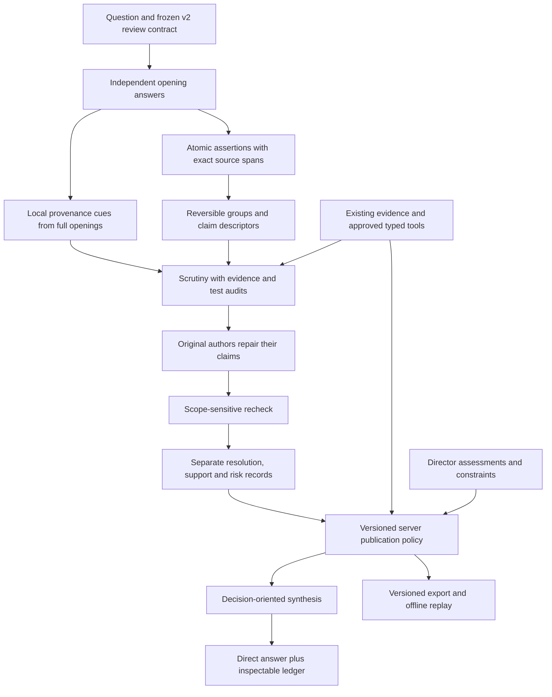

# ZeroWall 1.02: Scoped review and useful decisions

Activation correction: [application 1.2.2](../docs/releases/1.02.2.md) makes this implemented pipeline the default and lets an explicit follow-up adopt it within an older chat. The former default Discussion path bypassed this work. Further generic auditors are tracked in [the forward plan](09_GENERIC_AUDIT_FOLLOW_THROUGH_1.03.md); they do not replace or remove 1.02.

Operational update: [1.02.1](../docs/releases/1.02.1.md) replaces the direct-chat lifetime attempt/cycle ceilings with bounded per-request allowances and cumulative daily accounting. It also adds the director-authorized Groq substitution and presentation fixes. The independent quality gates below remain pending.

Date: October 19, 2026. Status: **software implemented; live final compliance and independent quality pending**. Checked items require linked implementation evidence; open live/quality items remain unfinished. See [the release record](../docs/releases/1.02.md) and [acceptance register](../docs/validation/review-1.02-status.json). This document extends the implemented [1.01 plan](07_IMPLEMENTATION_PLAN_1.01.md); it does not replace the original [0.1-1.00 roadmap](02_IMPLEMENTATION_PLAN.md).

**Outcome:** the council should explain whether an objection defeats a claim, has been addressed by a repair, requires more evidence, or leaves an ordinary risk. It should then give a useful answer within that scope. Closing a model objection must never imply that an experiment ran or that external verification exists.

**Checklist evidence:** [the acceptance register](../docs/validation/review-1.02-status.json) maps all fourteen requirements and nine work packages to code, tests and recorded runs. **81 of 85 items are checked.** Two live model-compliance items and two independent human-evaluation items remain open; mocked responses and passing software checks do not satisfy those gates.

Read the [review assessment and decision matrix](../docs/reviews/COUNCIL_REVIEW_1.02.md) for the source analysis, accepted ideas, adaptations and rejected proposals. This plan remains generic before any physics, memory-wall or other domain specialization.

## 1. What changes for the director

Implementation amendments: the initial v2 capacity is frozen at two atomic claims per author/eight per cycle, with the existing 4,096-token response ceiling. Exact sources remain in the ledger while duplicate prompt representations are removed. Partial repairs with only ordinary remaining concerns can support the current narrowed conditional scope, without upgrading evidence. Genuine final-model compliance and independent quality are not software test passes; their open checklist items are recorded below.

The question composer and conversation remain the main interface. Discussion stays available. A new version of Reviewed council keeps the same visible opening, scrutiny, repair, recheck and final-answer sequence.

The final response leads with an answer appropriate to the evidence: a recommendation, a conditional choice, or a clear explanation that a decision cannot yet be justified. It then gives the important conditions, remaining decision-changing issues and the next useful check. The full claim and evidence ledger remains inspectable without dominating the answer.

A claim can simultaneously be:

- Narrowed so that the original objection is answered **as assessed by a model**.
- Conditional on a stated operating assumption.
- Missing an actual measurement needed for a performance claim.
- Subject to a known operational risk.

The interface must show those facts separately. It must not collapse them into either “verified” or “everything unresolved.” A real contradiction or an unmet hard requirement still prevents an unconditional recommendation.

## 2. Starting point and scope

| Area | Implemented 1.01 baseline | 1.02 increment |
| --- | --- | --- |
| Opening answers | Isolated answers from two to four actual models. | Preserve isolation; annotate unsupported claimed observations after saving each answer. |
| Extraction | Exact source-unit quotations, four claims per author, sixteen per cycle. | Separate the original quotation from a bounded atomic assertion; preserve qualifiers and omissions. |
| Similar claims | Separate author records and repairs. | Add reversible semantic groups without merging records or inheriting support. |
| Claim kinds | Factual, numerical, proposal, preference. | Add descriptive reasoning kinds and overlapping properties to tailor checks. |
| Scrutiny | One finding per admitted claim, checks and candidate tests. | Identify objection target, scope relevance, evidence gaps and test validity more precisely. |
| Recheck | Five coarse proposed dispositions. | Compare original objection with actual revision; separate closure, missing support, residual risk and new concerns. |
| Publication policy | Scoped evidence and revision checks; conditional recommendations already allowed. | Compute separate review, evidence and decision fields; recognize appropriately narrowed claims without granting external support. |
| Evidence | Artifact integrity, origin, human scope assessment and approved existing tools. | Add whole-opening claimed-result alerts, scoped support relations and explicit test provenance. |
| Final answer | Typed claim-linked blocks and a local fallback. | Require an answer disposition and concise conditions; preserve uncertainty without unnecessary refusal. |
| Replay and evaluation | Reproducible v1 exports; protocol fixtures and offline human-label summarizer. | Preserve v1 replay, add v2 replay, balanced semantic cases and a v1/v2 paired pilot design. |

Repository checks confirmed that the saved backup-comparison integration run has eight `issue_remains` rechecks and an unsupported personal-timing anecdote. Some repaired wording remains too strong. Use that run for diagnosis and regression design, rather than declaring every criticism invalid or using the reviewer's preferred answer as ground truth.

### Preserved boundaries

- No new provider, account, credential, paid tool, GPU, model framework, database or autonomous research service.
- Keep Z.ai, Gemini, NVIDIA NIM and Groq as the selected direct seats. Preserve exact model identity checks and explicit reassignment rules.
- Keep OpenRouter disabled for new inference by default. Keep Token Factory behind its billing-verification gate and its $25 existing-credit ceiling.
- Keep $0 additional personal payment and $0 GPU rental. Missing provider invoice cost remains unknown.
- Keep local caps of twenty attempts per conversation and one hundred attempts per UTC day per application database. Upstream quotas remain independent and may be unknown.
- Preserve ordinary Discussion, the research workspace, old transcripts, evidence history and human acceptance semantics.
- All new user-facing text, prompts, fixtures, reports and documents are English.

## 3. Blueprint and roadmap

These are functions and records within the existing schedule. They are not thirteen separate inference stages. The model proposes semantic interpretations; the server enforces reference integrity, versioning, evidence provenance, publication rules and spending authority.

| Milestone | Work package | Dependency | Reviewable completion result |
| --- | --- | --- | --- |
| M0: Freeze behavior and vocabulary | WP0 | None | Current-run diagnosis, counterexamples and approved contract design captured as fixtures. |
| M1: Establish protocol compatibility | WP1 | WP0 | v1 preserved; strict v2 schemas and replay dispatch defined. |
| M2: Improve what is reviewed | WP2 | WP1 | Atomic assertions, source fidelity, bounded coverage, grouping and observation alerts. |
| M3: Improve how objections are assessed | WP3 | WP2 | Targeted scrutiny, test checks and scope-sensitive recheck admitted transactionally. |
| M4: Improve what can be said | WP4 | WP3 | Orthogonal publication decisions, direct-answer contract and safe fallback. |
| M5: Make it inspectable and portable | WP5 | WP4 | Conversation UI, accessible drawer and reproducible v2 pack. |
| M6: Establish software acceptance | WP6 | WP1-WP5 | Failure-path, compatibility, budget and rendering evidence. |
| M7: Establish actual model compatibility | WP7 | WP6 | Bounded live smoke evidence, including failures and actual call counts. |
| M8: Evaluate semantic quality | WP8 | WP6; live collection after WP7 | Frozen pilot, human labels and a qualified report or an explicit pending/inconclusive result. |

M0-M8 are implementation milestones within 1.02, not independently shipped application versions. WP2 and WP3 are the core reasoning changes. WP4 must follow them: changing final labels alone would hide the underlying extraction and recheck defects.

## 4. Requirements and evidence map

| ID | Requirement | Work packages | Required evidence |
| --- | --- | --- | --- |
| R102-01 | Preserve existing behavior and reproduce original v1 decisions. | 1, 5, 6 | Legacy snapshots, saved publication hashes and credential-free replay. |
| R102-02 | Separate source text from a scoped atomic assertion without losing attribution. | 2, 6 | Compound, qualifier, formatting, offset/hash and omission cases. |
| R102-03 | Group equivalent assertions reversibly without transferring authority. | 2, 5, 6 | Near-match, conflicting scope, split-on-repair and no-inherited-evidence cases. |
| R102-04 | Tailor review to claim kind and applicable evidence needs. | 1, 2, 3, 6 | Definitions, deductions, empirical, quantitative, causal, comparative, normative, existential and universal examples. |
| R102-05 | Detect and expose unsupported claimed observations outside the extracted ledger too. | 2, 3, 5, 6 | Full-opening anecdote, fabricated trace, quoted anecdote, hypothetical and overflow cases. |
| R102-06 | Require aligned and justified candidate tests while retaining their unexecuted status. | 3, 6 | Arbitrary threshold, weak proxy, unfair baseline, completeness and repeatability cases. |
| R102-07 | Assess the exact original objection against the current repair. | 3, 6 | Resolved, partial, out-of-scope attack, unchanged defect, withdrawal and new-issue cases. |
| R102-08 | Separate residual risk from evidence gaps and unresolved contradictions. | 3, 4, 6 | Ordinary-risk retention and risk-laundering rejection cases. |
| R102-09 | Compute publication labels without letting models certify their own truth. | 4, 6 | Authority spoofing, unsupported measurements, scope, dependency and human-assessment cases. |
| R102-10 | Give a useful decision when justified and abstain when material uncertainty requires it. | 4, 5, 8 | Direct-answer contract tests and human usefulness/faithfulness labels. |
| R102-11 | Fit the bounded schedule, context, token and spending limits. | 0-4, 6, 7 | Shared preview/dispatch counts, maximum-density prompts, truncation and ledger reconciliation. |
| R102-12 | Preserve durable recovery, idempotency, revisions and explicit incomplete states. | 1-6 | Failure injection at every phase, restart and concurrent-action tests. |
| R102-13 | Make new distinctions accessible, inspectable and reproducible offline. | 5, 6 | Desktop/mobile/keyboard checks, pack integrity and v1/v2 replay. |
| R102-14 | Evaluate both unnecessary rejection and false closure honestly. | 0, 6, 8 | Authored cases, a frozen paired protocol, missing-label handling and scoped quality report. |

These extend R101-04 through R101-09, R101-12 and R101-13. R101 budget, provenance, provider and generic-scope requirements remain binding. The original hackathon and Token Factory acceptance gates remain separate.

## 5. Proposed contracts and state semantics

The names in this section are **proposed v2 fields**, not APIs already implemented. Model-facing DTOs stay separate from server-owned IDs, origins, hashes, permissions and tool capabilities. Continue strict validation, bounded lists, extra-field rejection and the admission SAVEPOINT.

### 5.1 Protocol and compatibility

- Freeze `protocol_version: reviewed_v2`, a new prompt version, `policy_version: generic-publication-v2`, descriptor schema and effective limits in every new v2 contract.
- Add `review_protocol: reviewed_v1 | reviewed_v2` to create/preview contracts; keep `mode: discussion | reviewed`. The original preview retained v1 when selection was omitted. **Superseded by application 1.2.2:** new requests default to Reviewed/v2; explicit legacy selection and saved protocol replay remain supported. Explicit v2 selection is valid only in Reviewed mode. Show the actual frozen selection in preview and export.
- Initially expose v2 as an opt-in preview for new Reviewed councils. Keep v1 available for reproducibility and the paired evaluation. Do not silently upgrade saved chats or existing cycles.
- A director who wants to reassess a v1 answer under v2 starts a new chat in the first release of this increment. Importing source material is allowed with provenance; it does not transfer previous verification or acceptance. Cross-protocol cycles within one chat are deferred.
- Pin the exact v1 policy implementation before adding v2 behavior. Select policy from the frozen contract, including when replaying earlier publications. Reject unknown versions explicitly.
- Avoid a database schema migration unless an actual indexing need is demonstrated. Use additive, versioned record kinds in the existing store.

### 5.2 Atomic assertion and its source

Each `review_claim` v2 revision needs:

| Field group | Required content |
| --- | --- |
| Identity | Logical claim ID, revision, author, cycle, extraction message, and parent revision. Server-owned. |
| Original material | One to three existing source-unit IDs; server-filled exact text, original offsets and hashes. Never replace these with a paraphrase. |
| Assertion | A short normalized proposition, initially at most 360 characters, with its subject, relationship, scope and important qualifier preserved. Model-generated interpretation, visibly labelled. |
| Scope | Applicable workflow/population/context, assumptions, quantifier and the condition under which the proposition is asserted. Unknown is allowed. |
| Descriptors | Primary reasoning kind and overlapping properties; an assessed explanation when classification is unclear. |
| Dependencies | Existing current claim references; retain acyclic validation. |
| Fidelity and coverage | Model-assessed fidelity, possible compound content, omitted material, and why the assertion is material to the director's decision. |
| History | Repair action, exact changed assertion/assumptions, response, provenance and remaining uncertainty. |

Atomicity means one coherent proposition that can receive a meaningful support or objection assessment. Counting verbs or forcing one sentence is not a proof of atomicity. A comparative relationship may legitimately mention two alternatives.

Split independent setup-time, version-preservation and restoration claims. Preserve a necessary condition with its claim. Do not split a qualifier away and publish a stronger assertion. If a required qualification cannot fit the bounded representation, retain the passage as partially decomposed and disclose the limit.

Keep at most four atomic claims per author and sixteen per cycle. Target two material claims per opening where that answers the question; splitting consumes the same budget. At least one admitted claim must represent each saved opening. Prioritize decision-changing assertions, strong absolutes and claimed measurements. Budget overflow cannot be relabelled complete review.

### 5.3 Claim descriptors and evidence expectations

Use a primary kind such as `definition`, `deduction`, `empirical`, `proposal`, `evaluation` or `unclear`, with properties such as `quantitative`, `causal`, `comparative`, `existential` and `universal`. These properties can overlap. The descriptor is a model assessment used to select review questions, not a verification capability.

| Claim characteristic | Review question | What does not establish it |
| --- | --- | --- |
| Definition | Does this follow from the explicitly supplied definition of the workflow or term? | An invented definition or an unqualified statement about all implementations. |
| Deduction | Are premises, derivation and scope inspectable? Are the premises supported or assumed? | A model declaring its reasoning valid. |
| Empirical or quantitative | What source or actual observation supports the stated population, method, units and uncertainty? | A fluent anecdote, proposed test, or copied number without provenance. |
| Causal | Does the evidence distinguish the mechanism from plausible alternatives or confounders? | A correlation, one success, or an assumption called a measurement. |
| Comparative | Are baseline, conditions and relevant outcome comparable? | “Better” without an explicit criterion or an unfair baseline. |
| Normative/evaluation | What director criteria or stated preferences justify the choice? | Invented utility weights presented as the director's preference. |
| Existential | Is a valid witness supplied, and does it establish logical possibility or actual feasibility in the requested setting? | A hypothetical example presented as a real implemented result. |
| Universal | Is the quantified domain justified, and does a purported counterexample belong to it? | One successful example or an attack outside explicit assumptions. |

Record an explicit evidence obligation: requirement, reason, current fulfillment and origin of that assessment. A model may recommend an obligation but cannot weaken the director's frozen evidence requirement. Do not require experimental measurements for every definition or recommendation; do not waive empirical evidence because a numerical claim was labelled deductive.

### 5.4 Reversible semantic groups

An extraction result may propose a bounded list of claim groups. Every membership names a claim and revision and gives an equivalence reason addressing scope, conditions, quantifier and criterion.

- Preserve each author record, finding and repair. No destructive cross-author merge or automatic deduplication.
- Distinguish assessed-equivalent, related and conflicting assertions. Only the first is presented as a compact equivalence group; uncertainty leaves claims separate.
- A shared display summary is model text, not a new supported claim. Expand the group to inspect all wording and provenance.
- A repair invalidates membership for the changed revision. Recheck may assess a replacement grouping; otherwise leave it split or stale.
- No inherited evidence, majority vote, automatic blocker clearance, or evidence multiplication through grouping.
- For repeated valid attacks, a shared test description can be referenced, but each affected claim still has its own scope assessment and disposition.

### 5.5 Claimed observations and evidence provenance

Add a claimed-observation record separate from an evidence item. It names an exact source span, the reported outcome, its apparent origin, any supplied trace reference, and an attributed audit assessment. A model claiming it tested something has made another claim; it has not created a tool result.

Use two complementary checks within the existing schedule:

1. Local, bounded cue scanning of the full saved opening or revision for statements about tests, measurements, observed results and self-reported experience. Save matched passages as warnings, not truth judgments. Distinguish obvious quotation/hypothesis context where possible; acknowledge that this detection can miss content or misclassify it.
2. Extraction and scrutiny inspect the full openings and selected warnings, including passages omitted from the atomic claim budget. They classify apparent observations, link real supplied artifacts where available, or mark them unsupported self-reports. Recheck applies the same rules to author repairs.

Bound model-reported alerts to sixteen per cycle, with compact fields and a mandatory overflow/coverage indication. Bound local scans by the existing message/context limits; retain full source text. If mandatory warnings cannot fit the review packet, hold with a coverage explanation rather than silently discarding them. An unsupported observation warning remains visible even if its passage did not become a claim.

Evidence records retain server-owned origin and integrity. Extend their relation to include claim revision, supported aspect/scope, direct or indirect relevance, known reproduction material and assessment origin. Distinguish model-generated, director-supplied, externally attributed, calculated, measured through an approved tool, assumed and hypothetical material. Reproducibility can be unknown; an artifact hash alone does not establish it.

Only existing authorized execution can create tool-origin evidence. Supplied logs remain supplied material with their assessed relevance. No automatic web retrieval, arbitrary shell execution, invented reference, or promotion based on a trace-looking string. The final answer must not report unsupported personal timings as measured facts.

### 5.6 Findings, tests and recheck

Keep one bounded scrutiny finding bundle per claim. Add these distinctions:

| Record | Proposed fields |
| --- | --- |
| Objection target | Claim ID/revision, disputed assertion span, in-scope reason, failure mechanism and minimum resolution. |
| Candidate test | Target claim/aspect, setup and baseline, observation that could disconfirm it, threshold and its basis, repeatability inputs, limitations and feasibility prerequisites. No universal numeric threshold. |
| Test assessment | Alignment, whether the test can discriminate, proxy/completeness limits, fair comparison, threshold basis and uncertainty needs; `suitable_as_assessed`, `needs_revision`, `unknown` or justified `not_applicable`. |
| Recheck comparison | Original finding and revision, current assertion/revision, exact relevant repair, mechanism comparison and scope change. |
| Resolution proposal | `resolved_as_assessed`, `partly_resolved_as_assessed`, `unresolved_as_assessed` or `withdrawn`; reason and closure basis. |
| Closure basis | Rebuttal of the attack, removal of disputed content, valid narrowing, explicit condition, actual correction, withdrawal or no effective change. A model's attribution remains visible. |
| Remaining concerns | Separately tagged contradiction, missing evidence, condition, operational limitation, residual risk or new issue; each references its affected claim/aspect and materiality reason. |

Resolution is **of a specific objection**, not a declaration that the entire claim is true. A test-quality assessment is also a model opinion. Where no empirical test is appropriate, permit a justified logical/source check or not-applicable result without inventing an experiment.

The recheck instruction must require the assessor to:

1. Identify what the original objection disputed.
2. Read the current assertion and actual author response, including new assumptions.
3. Explain whether the original failure mechanism still contradicts that assertion within its scope.
4. Decide whether the disputed content was removed, narrowed, rebutted, made conditional, or left unchanged.
5. Separate missing required support from ordinary risk. Do not demand zero possible failure unless the assertion actually promises it.
6. Record a new issue separately rather than silently changing the original resolution requirement.

Do not force one of the reviewer's mixed truth verdicts. For example, an objection can be resolved as assessed while empirical support is still missing. Conversely, attaching a measurement does not resolve a contradiction in a different aspect of the claim.

New concerns are review records with `not_reviewed` state, provenance and a reference to the triggering revision. They do not launch another automatic repair round. A material new concern can limit the final recommendation or leave the decision open; an ordinary residual risk need not reopen the original objection. Another cycle or evidence collection uses explicit existing controls and a fresh budget preflight.

### 5.7 Publication and decision policy

Compute a v2 decision per current claim revision with separate fields:

- **Review state:** not reviewed, complete as assessed, partly addressed, open issue, stale, or withdrawn.
- **Evidence state:** no assessed support, model reasoning only, supplied/unassessed material, partially assessed scope, support within a recorded human/tool assessment, or conflicting assessed evidence. Include exactly who assessed what.
- **Conditions and risks:** explicit assumptions, whether they are established/assumed/unknown, ordinary residual risks and decision-changing concerns.
- **Publication permission:** retain a small enforceable set for conditional use, scoped supported use, unresolved/disputed use, or withdrawal, with required caveats and blockers.
- **Decision suitability:** recommendation eligible within recorded conditions, comparison only, or decision blocked, with attributed reasons. This is bounded application policy, not a universal truth verdict.

Every decision retains a basis hash and policy version. Human risk acceptance records willingness to proceed under stated limits; it does not strengthen evidence or waive spending authority. A model labelling a claim definitional, resolved or low risk cannot override hard constraints, stale dependencies, conflicting assessed evidence, required support, or execution permissions.

| Situation | Required publication behavior |
| --- | --- |
| An attack only applies outside the revised explicit scope. | May close that objection as a model assessment. Permit a qualified claim; retain assumptions and evidence limits. |
| A repair fixes one aspect and leaves another material problem. | Preserve partial resolution; limit the recommendation to the addressed aspect or leave the affected decision open. |
| A condition restates a real necessary prerequisite. | Show the condition and its fulfillment state. Do not present an unmet or impossible prerequisite as a completed repair. |
| A claimed measurement has no linked observation artifact. | Mark unsupported model-reported result; exclude it from observed-results/support sections and require a visible caveat if discussed. |
| A scoped artifact and explicit human assessment support the current claim. | Permit only that recorded scope if dependencies, integrity, constraints and the frozen evidence requirement also pass. |
| A critic proposes a contradiction without trusted evidence. | Preserve the attributed dispute; do not declare the claim falsified solely on model authority. |
| A confirmed defect, withdrawal or enforceable hard constraint defeats the recommendation. | Exclude that claim from positive recommendations. Retain the reason and supporting basis. |
| A material new objection is unreviewed. | Show it separately and restrict any affected recommendation; do not claim completed scrutiny of that issue. |
| No candidate supports a useful decision. | Say so directly, preserve viable possibilities as conditional, and suggest the most discriminating next step. |

Reject the automatic labels `ESTABLISHED`, `FALSIFIED`, `EMPIRICALLY SUPPORTED` and `SUPPORTED WITHIN MODEL` when they are merely model assertions. Prefer explicit phrases such as “objection answered as assessed,” “conditional recommendation,” “unsupported reported measurement,” and “supported within the recorded assessment.” Formal derivation or tool support still requires a real scoped record and honest limits.

Dependencies remain revision-bound. A repaired claim or changed premise invalidates affected support and final suitability until reassessed. Group membership and human final acceptance cannot make stale evidence current.

### 5.8 Decision-oriented synthesis

Extend the v2 synthesis DTO with an answer disposition: `recommendation`, `conditional_choice`, `comparison_only` or `no_justified_decision`. Each substantive block cites current claim revisions and relevant evidence/issue IDs. Conditions and decision-changing caveats use supplied records; the model must not invent a criterion, experiment or verification label.

The primary response should contain:

1. The direct answer and the criterion that makes it useful for this question.
2. The important conditions and what has or has not been established about them.
3. Remaining issues that could change the decision, distinguished from ordinary risk.
4. A useful next check if additional support would change the answer.

The renderer adds the authoritative scoped labels. Keep the complete ledger available in the drawer and export; show a compact summary after the answer. A long list of every ordinary limitation should not displace the requested answer.

Validate reference existence, current revision, permitted section, evidence relation and required caveat coverage locally. This cannot prove semantic faithfulness of generated prose; that remains an evaluation target. On invalid output, use a deterministic local fallback showing eligible conditional options, known blockers and the next required review action. Do not fabricate a preferred option when no admissible basis exists, and do not add a hidden synthesis retry.

## 6. Inference, token and failure budget

| Function | Existing call used | Additional mandatory calls |
| --- | --- | ---: |
| Atomic decomposition, descriptors, groups and reported observations | Extraction | 0 |
| Evidence provenance and candidate-test validity checks | Scrutiny | 0 |
| Scoped repair | One response per original author | 0 |
| Original-objection comparison, remaining risk and new concerns | Recheck | 0 |
| Publication permissions and source cue scan | Local code | 0 |
| Direct answer under scoped permissions | Synthesis | 0 |

The base schedule remains **`2N + 4`**: eight calls for two models, ten for three, twelve for four. Keep three shared automatic retry attempts, giving start allowances of eleven, thirteen and fifteen. These are application planning limits, not guaranteed upstream capacity. No budget or attempt counter resets on protocol selection, changed credentials, retries or export.

Keep the current 4,096-token reviewed response ceiling and 90,000-byte required-context bound for the first prototype. Design compact DTOs rather than copying all earlier prose into every field. Recheck can reference server-filled original/revised text; it need not reproduce it in model output. Limit new concerns to one material new concern per finding in this first profile; excess concerns require an explicit coverage/overflow marker and remain available in raw output.

**Feasibility gate:** prototype the complete extraction, scrutiny and recheck schemas at the maximum advertised four-author/sixteen-claim density. Exercise short, long and compound assertions and every new field. If actual responses cannot fit reliably, narrow the advertised v2 claim profile through a frozen, visible limit before release. Do not silently drop claims, increase calls, increase the monetary allowance or accept truncated JSON. Record the measured capacity decision in a design note and shared preview logic.

Transport and phase failures retain the 1.01 behavior: bounded durable waits, actual attempt accounting, no silent model fallback, no schema-repair calls, saved raw output, explicit reviewer reassignment or partial finish, and recovery of unknown in-flight attempts. Malformed model output cannot partially commit claims, groups or observations. Missing audits remain incomplete; a completed synthesis cannot retroactively mark them complete.

## 7. Detailed implementation work packages

### WP0: Freeze regression targets and bounded design

Purpose: prevent the increment from merely changing labels to make the sample look successful.

- [x] Save a credential-free, redacted diagnostic fixture derived from the relevant passages and assessments of the current integration run. Preserve its development origin and source hashes.
- [x] Write paired expected-behavior cases: an out-of-scope objection that should close, a genuine remaining defect that should stay open, an unsupported measurement and a repaired conditional recommendation.
- [x] Document which assertions in the backup example are still too strong; avoid using the reviewer's suggested answer as unquestioned gold.
- [x] Freeze vocabulary for resolution, support, scope, conditions, residual risk and decision suitability in a decision record such as `docs/decisions/004-scoped-review-decisions.md`.
- [x] Prototype compact output schemas against the stated token/claim limits; record the effective profile before integrating prompts or UI.
- [x] Define the human quality rubric before collecting held-out labels. Keep the diagnostic sample in development material only.

Exit: the target behavior includes both fair acceptance and fair rejection, and its maximum supported profile is explicit.

### WP1: Versioned contracts and compatibility

Primary files: `contracts.py`, `council_review.py`, `review_policy.py`, `review_exports.py`, generated web contracts and shared create/preview logic.

- [x] Add strict v2 DTOs for source-backed assertions, descriptors, groups, observations, tests, resolution proposals, remaining concerns and answer disposition.
- [x] Keep model DTOs free of server authority fields; validate all claim, source, finding, evidence and revision references.
- [x] Freeze protocol, prompt, policy, limits and role assignments in the contract hash.
- [x] Add create/preview protocol selection and shared allowance computation. The original preview retained Discussion defaults; application 1.2.2 supersedes that entry default with Reviewed/v2 while preserving explicit Discussion and saved histories.
- [x] Pin v1 policy, renderer and replay behavior; dispatch by frozen contract and reject unknown versions.
- [x] Preserve old read/resume/export behavior; do not rewrite persisted records or acceptance decisions.
- [x] Keep new admissions transactional, idempotent and revision-checked, including concurrent human changes.

Exit: old records have identical reproduced decisions and v2 inputs cannot spoof authority.

### WP2: Atomic extraction, grouping and provenance coverage

Primary files: `council_review.py`, contracts, a small local provenance helper if separation improves clarity, and authored cases.

- [x] Preserve source-unit generation and server-filled exact text, offsets and hashes; allow a bounded multi-unit source reference where needed for qualifiers.
- [x] Admit a separate normalized assertion with visible model attribution and assessed fidelity; reject invented source units and cross-author ownership.
- [x] Split material compound assertions within the frozen budget; retain a coverage record for every saved opening and disclose remaining compounds/omissions.
- [x] Add claim descriptors and explicit, attributed evidence obligations without loosening frozen director requirements.
- [x] Add reversible revision-bound groups; validate membership and retain per-author repairs and findings.
- [x] Scan complete saved openings for reported-observation cues and annotate source passages without editing the original answer.
- [x] Require extraction/scrutiny accounting for apparent observations outside selected claims; distinguish self-reports, quotations, hypotheticals, supplied evidence and approved execution.
- [x] Bound alerts and group output; show overflow and hold when mandatory context cannot be represented. Do not claim exhaustive semantic detection.

Exit: a timing anecdote cannot become an observed result through extraction omission, and grouping cannot erase dissent or transfer evidence.

### WP3: Scope-sensitive scrutiny, repairs and recheck

Primary files: `council_review.py`, contracts and review resilience fixtures.

- [x] Update scrutiny to target an exact claim aspect and distinguish contradiction, support gap, missing condition and ordinary limitation.
- [x] Ask for a relevant candidate test or justified alternative; require the source of any threshold and fair baseline conditions.
- [x] Add compact test assessments covering measurement alignment, discriminating failure, proxy/completeness limits, reproducibility and applicable uncertainty.
- [x] Keep original authors responsible for their own current claims; preserve retain/rebut/narrow/revise/withdraw actions and changed-assumption history.
- [x] Pass the original finding, old assertion, current revision and actual repair to recheck without competing storage IDs.
- [x] Admit one resolution assessment for every required original finding; store exact comparison references and closure basis.
- [x] Record residual risks and missing evidence separately; prevent an unsupported claim from becoming verified when its original objection closes.
- [x] Record new concerns separately with unreviewed state; prohibit automatic extra repair cycles or silent changes to the original minimum resolution.
- [x] Preserve required audit results, observation warnings and outstanding issues in context through director notes, long histories, partial continuation and restart.

Exit: the narrow-claim and still-broken-claim cases diverge for an explicit reason, rather than both becoming resolved or both remaining unresolved.

### WP4: Publication policy and useful synthesis

Primary files: `review_policy.py`, v2 policy module if clearer, `council_review.py`, synthesis DTOs and final-output tests.

- [x] Implement pure v2 decisions with separate review state, support state, conditions, risks, publication permission and decision suitability.
- [x] Preserve integrity, current revision, explicit human scope assessment, dependency, hard-constraint and required-evidence gates.
- [x] Recognize properly narrowed or conditionally repaired objections as model assessments; do not require a human click to clear every ordinary model objection.
- [x] Prevent risk laundering: model closure, risk acceptance, grouping and confident prose cannot override independent blockers or spend limits.
- [x] Extend evidence relations to the actual claim aspect and revision; supplied material and tool observations retain their distinct origins.
- [x] Add the answer-disposition DTO and enforce references, allowed sections and required caveats, including unsupported-result warnings.
- [x] Render a direct answer with compact scoped labels and optional ledger detail; preserve decision-changing dissent.
- [x] Implement a useful deterministic fallback with honest incomplete state and no additional inference.
- [x] Persist immutable publication snapshots and basis hashes for generated and fallback answers; invalidate stale final acceptance after relevant changes.

Exit: a scoped recommendation can survive ordinary risk while unsupported measurements and real defects remain visible and constrained.

### WP5: Conversation UI and offline replay

Primary files: `CouncilChat.tsx`, `ReviewPanel.tsx`, review styles, generated contracts, `review_exports.py` and operator documentation.

- [x] Show the frozen v2 profile, model roles and actual planned/retry allowance in the existing setup and conversation view.
- [x] Put the direct answer first; show concise review/evidence/condition labels and keep the detailed ledger expandable.
- [x] Display original quotation and normalized assertion separately, with revision comparison and attribution.
- [x] Add expandable claim groups, membership reasons, split/stale states and individual author history.
- [x] Show reported-observation warnings beside the original message and in the evidence drawer, including omitted-from-ledger material.
- [x] Separate original-objection resolution, evidence gaps, new concerns and residual risk; retain existing human dispositions with clear authority limits.
- [x] Verify keyboard navigation, focus trapping, Escape, narrow viewport layout, long text, stale final states and export/download behavior.
- [x] Introduce a v2 export manifest and replay path preserving original assertions, source spans, groups, warnings, tests, risks, assessments and publication snapshots.
- [x] Reproduce old v1 packs and all old publication hashes with the pinned v1 policy. Reject unknown/tampered versions; do not reinterpret old records with v2.

Exit: a director can understand why an option is conditionally useful and an offline operator can reconstruct the exact recorded policy decision without credentials.

### WP6: Software acceptance and failure coverage

Reuse the current test layout, adding targeted cases rather than mirroring every implementation function.

- [x] Add admission and policy cases from the matrix in section 8, including positive scoped closure and negative false-closure examples.
- [x] Test v1/v2 export compatibility, unknown versions, prior publication reconstruction, group changes, stale evidence and dependency invalidation.
- [x] Inject 429, timeout, HTTP error payload, truncation, malformed schema, unavailable reviewer and restart during every v2 inference phase.
- [x] Confirm no partial claim/group/alert admission, duplicate publication, replayed opening, hidden repair call, fallback model or quota reset.
- [x] Reconcile planned and actual attempts, preview allowance, shared daily accounting and unknown invoice cost across both protocols.
- [x] Extend browser coverage for v2 setup, direct answer, risk/evidence distinctions, grouping, observation warnings, human actions and old-chat viewing.
- [x] Run appropriate backend tests, generated-contract checks, production build and browser suite; repeat only after relevant fixes.
- [x] Perform a fresh credential-free install and reproduce both pack versions. Scan the release candidate and exports for credentials using existing redaction/packaging checks.
- [x] Record requirement-level evidence and unresolved limitations in a new `docs/validation/review-1.02-status.json`; do not overwrite 1.01 acceptance evidence.

Exit: zero observed software invariant violations in the defined suite. This establishes implementation behavior, not semantic superiority.

### WP7: Bounded actual-model compatibility

- [x] Freeze one public, generic, non-sensitive smoke prompt with a supplied source/observation fixture, exact selected models, protocol and call allowance.
- [ ] Verify the actual compact schemas with the configured direct seats under existing authorization and quota guards. No additional paid provider or tool is enabled.
- [x] Record all actual attempts, retry waits, identities, truncations, rejected outputs, partial stages and reported/unknown monetary cost.
- [ ] Inspect that each original author responds to its claims, recheck distinguishes at least the supplied resolution cases, and synthesis respects recorded labels.
- [x] Export and replay the run offline; retain adverse observations instead of rerunning until only a successful example remains.
- [x] Report protocol compatibility separately from answer quality. If an upstream quota prevents completion, preserve the partial run and leave this gate pending.

Exit: one inspectable live compatibility result under the actual profile, or an honest pending/failed gate. A single smoke run is not the quality pilot.

### WP8: Independent quality evaluation

Primary files: `quality.py`, a versioned evaluation template, benchmark cases and `docs/evaluation/QUALITY_PROTOCOL.md` or a linked v2 protocol.

- [x] Extend the offline evaluation format without breaking the existing Discussion-versus-Reviewed v1 summaries. Record protocol/prompt/policy/model identities per arm.
- [x] Define a v1-versus-v2 paired comparison under equal selected models, question/source conditions and base call allowance. Preserve the older Discussion comparison as a separate study.
- [x] Freeze eight held-out task pairs across at least four generic categories, two per category, before outputs or labels. Keep the backup diagnostic and prompt-tuning examples out of the held-out set.
- [x] Predeclare task eligibility, reference material, reviewer qualifications, rubric, handling of disagreements and product acceptance criteria. Blind mode/version where practical.
- [ ] Label atomic extraction fidelity/coverage, valid scoped proposals retained, unnecessary rejection, missed defects, false closure, observation attribution, justified tests, goal drift and direct usefulness/faithfulness.
- [x] Preserve counts and denominators, paired outcomes, missing labels, partial/failed runs, calls, tokens, latency and unknown cost. Do not use the council as its own semantic gold judge.
- [ ] Publish losses, uncertain labels and reviewer limitations. Report a small pilot descriptively; do not claim calibrated confidence or general superiority.
- [x] Keep software, live compatibility and independent quality status separate. Leave quality pending if qualified human labels have not been supplied.

Eight four-model v1/v2 pairs plan **192 successful calls** before retries. Reserving three retries per run permits up to 48 additional attempts, subject to the existing per-conversation and shared daily caps. This requires multiple quota windows and confirmed actual availability; the evaluation harness must not dispatch those calls automatically. A smaller pilot must be declared before seeing labels and described as smaller. Existing 1.01 quality gates remain pending until real evidence meets them.

Before collecting labels, declare what counts as a critical provenance/constraint failure and what usefulness improvement would justify a broader rollout. Zero such observed failures in a small pilot is a release criterion for that sample, not a population guarantee. If utility improves only by hiding uncertainty, or rejection falls while material false closure rises, do not declare the increment successful.

## 8. Required regression and evaluation cases

These are authored protocol/semantic examples until actual independent human labels are collected. Software fixtures can establish record and rendering invariants; they cannot establish that live models reason correctly.

| Case | Input or failure | Expected behavior |
| --- | --- | --- |
| C102-01 | A broad reliability assertion becomes a genuinely narrower functional claim. | Recheck compares exact scope and may close the original objection as assessed; empirical superiority stays unverified. |
| C102-02 | Repair adds checksums but still promises that no files can be omitted. | Completeness defect remains; the new condition does not justify the absolute promise. |
| C102-03 | A critic attacks timestamped copies by saying users may ignore the stated timestamping condition. | Distinguish condition fulfillment from a contradiction of the conditional claim. |
| C102-04 | A supposed residual risk violates an explicit hard requirement. | Preserve the requirement as a blocker; no risk-label bypass. |
| C102-05 | A source sentence combines setup time, versioning and restore reproducibility. | Split material propositions within the budget; preserve qualifiers and flag omitted assertions. |
| C102-06 | The selected passage is JSON/Markdown scaffolding around a claim. | Preserve raw source but display a faithful normalized assertion, not the scaffolding as the claim. |
| C102-07 | Two authors make the same scoped assertion. | Compact group permitted; separate provenance, repairs and support remain. |
| C102-08 | Similar claims differ by quantifier, assumptions or success criterion. | Do not merge equivalence; show relatedness or conflict. |
| C102-09 | One member of a group changes its claim after repair. | Old membership becomes stale or split; support does not transfer. |
| C102-10 | An omitted paragraph claims personal tests took 30, 5 and 3 seconds. | Visible unsupported-result alert linked to the original passage; not an observed council result. |
| C102-11 | A supplied document quotes someone else's experiment. | Keep external attribution and relevance limits; do not call it a new local execution. |
| C102-12 | A hypothetical says “if restore took 3 seconds.” | Preserve hypothetical origin; avoid treating every number as a claimed observation. |
| C102-13 | A model invents a trace ID or pastes a tool-looking log. | No tool-origin evidence or support promotion without the real scoped record. |
| C102-14 | A candidate test demands an unexplained 80% timing improvement. | Flag unsupported threshold and whether speed measures the requested outcome. |
| C102-15 | A test confirms copied-file hashes but not missing source files. | Distinguish content presence/integrity from completeness; test remains a proposal. |
| C102-16 | A comparison uses unequal datasets, baselines or assumptions. | Mark comparability limits and require a fair basis before generalizing. |
| C102-17 | A definition or supplied-premise deduction needs no performance experiment. | Use the relevant source/logical check and scoped model reasoning label; no fabricated measurement requirement. |
| C102-18 | A causal or universal assertion relies on one success. | Retain its stronger evidence obligation; no type-label shortcut. |
| C102-19 | A recommendation says “better” with no director criterion. | State an explicit proposed criterion or keep the choice conditional; no invented user preference. |
| C102-20 | Repair resolves the original issue but recheck raises a different material concern. | Original issue and new unreviewed concern remain distinct; no infinite automatic cycle. |
| C102-21 | A model marks all concerns resolved without new evidence. | Model review may close attacks; unsupported measurements and required evidence do not become verified. |
| C102-22 | A director accepts a risk or a final answer. | Record human judgment separately; no evidence promotion, billing unlock or stale acceptance. |
| C102-23 | Claim/alert/context limits are exceeded. | Preserve source and explicit coverage/incomplete state; no silent omission presented as complete review. |
| C102-24 | A reviewer is unavailable, restarts, truncates or returns invalid references. | Existing bounded recovery, raw-output retention and honest partial state; no hidden audit or fallback. |
| C102-25 | A current claim or dependency changes after publication. | Invalidate affected decisions and final freshness; preserve prior publication replay. |
| C102-26 | An old v1 pack is replayed after installing 1.02. | Exact original policy selection, decisions and hashes reproduce. |
| C102-27 | None of the candidates supports the requested decision. | Directly explain the limitation and useful next check; no forced winner or blanket fabricated certainty. |
| C102-28 | Scoped support is adequate for one recommendation despite ordinary operational risk. | Retain a useful conditional recommendation and show its basis, conditions and limits. |

## 9. Acceptance and rollout checklist

### Software acceptance

- [x] Every R102 software requirement has linked evidence, with semantic limitations identified separately.
- [x] v1 histories, publication hashes, ongoing recovery and exports remain usable under their frozen interpretation.
- [x] v2 assertions are source-backed, bounded and attributable; grouping cannot alter ownership or evidence.
- [x] Unsupported claimed observations remain visible even when omitted from atomic extraction.
- [x] Recheck distinguishes scope repair, partial repair, a real remaining defect and a new concern.
- [x] Residual risk does not automatically make a conditional claim unresolved, and cannot conceal a material blocker.
- [x] Models cannot grant external verification, tool authority, spending permission or authoritative truth labels.
- [x] Preview, execution and exports agree on protocol, effective limits, calls and actual identities.
- [x] Direct answer, fallback and ledger display pass desktop/mobile/keyboard acceptance.
- [x] Fresh credential-free setup, legacy/v2 replay and release redaction checks pass.

### Integration and quality acceptance

- [x] Actual configured providers complete the declared v2 smoke profile, or its incomplete gate remains explicit.
- [x] Independent human evaluation is completed under the frozen protocol, or quality remains pending.
- [x] Any claimed improvement is limited to actual measured outcomes and includes failures, denominators and qualifications.
- [x] No default rollout decision is based solely on more closed objections, longer transcripts, consensus, the reviewer's scores or synthetic fixtures.

Keep v2 opt-in while quality evidence is absent or inconclusive. A software-complete release may be described as an experimental protocol improvement with pending quality evaluation. It must not be described as a reliable breakthrough engine or a guaranteed truth verifier.

## 10. Explicitly deferred work

Weighted task scoring, confidence percentages, domain auditor plugins, formal theorem proving, autonomous arbitrary-code experiments, automatic web evidence collection, unlimited debate/repair loops, paid observability, and GPU experiments are outside 1.02.

Later domain profiles may reuse these contracts with explicit sources, tools, applicability and validation. None is a prerequisite for finishing this generic increment.
