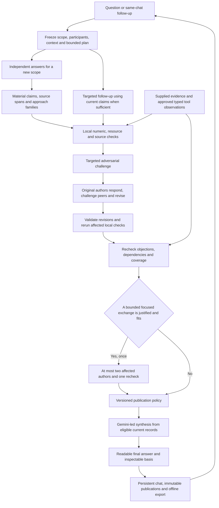

# ZeroWall 1.03: one unified Council baseline

Date: October 19, 2026. Status: **software implemented and locally validated; live full-review reliability and independent quality pending**. Checklist: **63/66 complete**; three independent evaluation tasks remain open.

The running application is 1.3.0. Software evidence and remaining gates are recorded in [the acceptance register](../docs/validation/council-1.03-status.json) and [release record](../docs/releases/1.03.md). Checked items refer to implemented software and recorded tests, not a claim of superior intelligence. The genuine four-provider run produced an explicitly partial comparison after timeouts/rejections/rate limits; it is not a complete live review pass.

Product name in the application: **Council**. The release number belongs in engineering documents, frozen records and export metadata. The normal interface has no release selector, review-method selector or Discussion/Reviewed mode selector.

This is the authoritative forward plan. It consolidates the [1.01 foundation](07_IMPLEMENTATION_PLAN_1.01.md), [1.02 improvements](08_IMPLEMENTATION_PLAN_1.02.md), discussion continuity and presentation fixes, and the useful proposals assessed in [the N4 review](../docs/reviews/N4_REVIEW_AND_FORWARD_DIRECTION.md). It supersedes the separate [audit-only 1.03 draft](09_GENERIC_AUDIT_FOLLOW_THROUGH_1.03.md) as an implementation sequence. That draft remains historical design material; its useful requirements are mapped below.

## 1. Product decision

Ask one question. Each selected model answers independently. The council identifies the important assertions and distinct approaches, challenges them, lets their authors answer and revise, checks the revisions, and produces a useful final answer. Follow-ups continue the same conversation and revisit the affected reasoning.

The hybrid is an execution change as well as a simpler interface. The author-response round becomes a public deliberation: each model answers objections to its own work, can challenge a specific peer assertion, and explains what changed. Structured records preserve those exchanges. The existing review machinery supplies traceable claims, evidence boundaries and publication checks. Generic audit services add bounded numerical, resource and citation checks where applicable.

The deliverable is the strongest supported answer the current process can justify. Useful speculative approaches remain available with their assumptions and evidence limits. Agreement, eloquence, role names and repeated suggestions do not establish truth. An unresolved result can still identify promising alternatives and the next discriminating test.

### Non-negotiable requirements

| ID | Requirement | Acceptance reference |
| --- | --- | --- |
| U01 | One current Council workflow; no visible protocol/version/mode choices. | WP1, WP8, R01 |
| U02 | Independent openings followed by actual targeted exchanges and author revisions. | WP2, WP5, R02-R03 |
| U03 | Retain the 1.01 foundation and all useful 1.02 semantics, including evidence/risk separation. | WP0, WP3, WP6, R04 |
| U04 | Review material assertions and expose omitted coverage. | WP3, R05 |
| U05 | Add bounded equation, quantity, resource and citation audit records. | WP4, R06-R08 |
| U06 | Keep creative proposals distinct from established facts; produce a direct, readable answer. | WP6, WP8, R09 |
| U07 | Distinguish independent approach families from variants and repeated components. | WP3, WP6, R10 |
| U08 | Preserve the same chat, historical records, dependencies and reproducible publications. | WP0, WP7, R11-R12 |
| U09 | Prefer Gemini as lead; preserve actual participant identity and disclosed role reuse/substitution. | WP2, WP7, R13 |
| U10 | Maintain bounded recovery, existing funding gates and cumulative accounting. | WP2, WP7, R14-R16 |
| U11 | Evaluate scientific/semantic quality separately from workflow correctness. | WP9, R17 |
| U12 | Remain generic and English-only before domain specialization. | WP3-WP6, WP9, R18 |

## 2. What is retained and what evolves

| Existing asset | Retained behavior | Forward change |
| --- | --- | --- |
| Discussion | Independent answers, visible exchanges, steering and same-chat continuity. | Exchanges reference actual claims and objections; no separate Discussion path in the normal composer. |
| 1.01 engine | Durable schedule, original-author replies, revisions, evidence records, governed transitions, exports. | Reuse stable primitives; add an explicit current protocol without changing saved meanings. |
| 1.02 extraction | Atomic assertions, exact source spans, qualifiers, coverage and reversible groups. | Add materiality planning, typed audit attachments and approach families. |
| 1.02 recheck/policy | Separate objection resolution, evidence strength, ordinary risk and decision suitability. | Include new audits and late peer objections, with publication invalidation when dependencies change. |
| Operational patches | Per-request allowance, cumulative daily ledger, named Groq replacement, Gemini lead, dark mode and readable math. | Integrate these into one server-generated execution plan and one UI. |
| Review inspector | Source comparisons, revisions, findings and evidence provenance. | A progressive-disclosure Details view linked from the relevant answer or exchange. |
| Research workspace | Typed experiments and existing evidence/decision tools. | Reuse approved capabilities and provenance; no mandatory move out of chat. |

The recorded routing correction is [application 1.2.2](../docs/releases/1.02.2.md). Its 269 backend tests and 13 browser scenarios establish a baseline for preservation. They do not validate the new hybrid or demonstrate scientific superiority.

## 3. User experience blueprint

The first screen has the question composer, selected model chips, optional attachments/answer requirements and **Start council**. Model/provider identities and the current allowance remain discoverable. Connection settings retain the existing billing gates. Nobody has to choose an algorithm, review generation or number of debate rounds before asking a question.

The conversation presents these plain-language stages:

1. **Independent answers** — separate replies from the selected models.
2. **Key claims** — a compact shared map of the material assertions and distinct approaches; detailed records expand on demand.
3. **Challenges** — specific objections, calculations, missing support and discriminating tests.
4. **Responses and revisions** — each original author answers; peer challenges link to the assertion being disputed.
5. **Checks** — what the revisions resolved, what remains conditional and what could not be checked.
6. **Final answer** — the requested deliverable first, then its basis, conditions, unresolved decision-changing issues and next useful check.

Stages are activity labels, not menus. The visible exchange must read as a group conversation. A technical record must have a readable rendering before its phase can be considered complete. JSON is an internal transport format; raw artifacts remain downloadable. Equations render locally, code remains code, and malformed formulas have a readable text fallback.

User-facing examples:

| Situation | Intended wording/behavior |
| --- | --- |
| A model changes its proposal | "Revised after the resource objection" with a link to the original assertion and the change. |
| A calculation succeeds | "Arithmetic checked under these inputs"; include inputs and limits in Details. |
| A reference was only generated by a model | "Source not checked"; no verified-source badge. |
| A decision remains conditional | Give the conditional choice and say which assumptions could change it. |
| A later challenge remains unanswered | Keep it open and show the next useful action; no artificial consensus. |
| Daily allowance is exhausted | "Today's local allowance is used. Your council is saved; continue here when it resets." |
| Older conversation receives a new request | "Continuing with claim review. Earlier answers keep their original review status." |

There is no version badge or "Keep old method" toggle in the normal UI. Historical methods may be described as **Earlier discussion** or **Earlier review** where needed to avoid implying that an old answer was checked. Original stored text and technical exports remain intact.

## 4. Formal execution blueprint

The diagram describes logical work. It does not allocate a model call to every box. Local checks and policy evaluation do not require inference. A call plan records its actual route and count before dispatch.

### Phase contracts and authority

| Phase | Inputs and outputs | Authority/limit |
| --- | --- | --- |
| Freeze | Full current request, deliverable, constraints, supplied evidence, participants, call/context envelope and hashes. | Code validates and persists. Missing optional requirements remain unspecified. |
| Independent answers | Each model gets the same scope/evidence and no peer answers. Readable proposal, assumptions, main assertions and limitations. | Isolated model proposals, not established facts. |
| Claim map | Exact source spans, atomic assertions, revisions, dependencies, materiality, coverage and approach relations. | Model interpretation admitted only after reference/shape validation. |
| Local checks | Typed representations tied to source spans and current revisions; bounded outputs and limitations. | Deterministic result certifies only the declared operation/inputs, never the whole scientific proposition. |
| Challenges | Strongest valid objections, counterarguments and candidate tests, covering every admitted material claim. | Critic assessments; missing support is different from contradiction. |
| Responses and revisions | Original author answers findings and can raise bounded peer objections. Original/revised scopes remain linked. | Each author changes only its own assertions. Peer objections do not mutate another author's record. |
| Recheck | Exact original objection, author response, revisions, local results and outstanding peer issues. | Recorded assessment; no invented evidence or automatic closure from fluency. |
| Publication | Pure decisions from frozen current records, dependencies, evidence and coverage. | Versioned server policy controls labels and admissible sections. |
| Synthesis | Requested deliverable, current eligible assertions, approach families and unresolved issues. | Gemini is the preferred writer; it cannot override publication permissions. |

### Model role allocation

Keep the configured Z.ai, Gemini, NVIDIA NIM and Groq seats and the actual configured upstream IDs. This plan does not claim those upstreams will always be available or replace their configuration with guessed model names.

Gemini leads scope interpretation within the extraction call and writes the final answer. A different selected model performs the main adversarial scrutiny; another performs recheck where participation permits. Original authors own their revision turns. With two models, roles necessarily repeat: record that reduced diversity, use the other model to recheck the critic where possible, and never call role reuse independent external validation.

Gemini unavailability is disclosed. Reassignment may use another already selected, available participant under a recorded role rule; it does not silently add an unselected model or provider. Preserve the existing authorized Groq free-model replacement after two eligible primary failures, actual model attribution and bounded attempts. A missing mandatory phase remains incomplete until completed/reassigned or explicitly published as partial.

## 5. Discussion mechanics inside the review

Use the original-author response pass for deliberation. Every response contains a readable explanation and bounded typed records: responses to assigned findings, any revised assertion/scope, remaining uncertainty and up to two peer challenges. A peer challenge must cite an existing claim/revision and state why the issue can change the requested decision.

The pass uses a deterministic, recorded order, rotated between cycles to avoid always giving one seat the last word. Every author receives the frozen openings and main findings. Later authors may additionally see admitted earlier responses in that pass, clearly separated from the original baseline. Persist the exact context and visible-message IDs for each request. Do not describe these response turns as independent.

New peer challenges start as pending findings. A subsequent original-author response can answer an earlier peer challenge; an author who already spoke has not implicitly answered a later challenge. Recheck must track that distinction. A revision cannot erase the original objection, change another author's words or silently broaden the question.

After the initial recheck, allow **one focused exchange** when all of the following hold: a recorded unresolved issue can change the final choice; the affected current assertions are identifiable; at most two author responses can address it; and the remaining request/daily/provider budget covers those responses, a recheck, the final synthesis and remaining recovery reserve. The trigger is a bounded scheduling decision over recorded reasons, not a claim that code knows which scientific position is true.

The focused exchange contains only those author responses and one recheck. It cannot recursively request another exchange. If the issue is larger, publish the honest current result and offer **Continue council** in the same conversation. The final answer can remain conditional; the process never argues indefinitely until agreement.

New mechanisms introduced during repair are unreviewed candidates unless they fit a new, explicitly tracked review scope. No late idea gains accepted status by appearing in the final prose. Ranking and qualification changes must point to the relevant claim, finding or check.

Candidate tests retain method, observable/disconfirming outcome, fair baseline, threshold and its basis, limitations, confounders and repeatability/resource requirements. Recheck assesses whether the test can distinguish the actual competing assertions and whether its proxy supports the claimed conclusion. A proposed test can be unsuitable or uncheckable without proving that the underlying idea is false. Execution requires an existing approved typed capability and its own recorded authority; proposing a test never executes it automatically.

## 6. Coverage and the generic audit layer

### Materiality before more records

Preserve the full source. Record a bounded inventory of requested deliverables, approach candidates, numerical/equation passages, evidence assertions and possible hard-constraint conflicts. Its completeness is an assessment with a visible limit; a text scanner alone cannot guarantee semantic coverage.

Retain the initial core review envelope of up to eight atomic assertions, normally two per author. Within that envelope, prioritize assertions on which the requested answer or ranking depends and explain the selection. A family-count request, such as five approaches, must either have candidate coverage within the envelope or disclose why it does not. Do not silently certify an entire long opening because two assertions were inspected.

The inventory and final answer must expose: material examined, unreviewed candidates, overflow and missing representations. Additional material requires a bounded follow-up batch in the same chat. A missing coverage record fails admission; a plausible but incomplete coverage assessment is not converted into a completeness guarantee.

### Audit records

Every record has an ID, source span/hash, claim and revision references, scope, origin, check/schema version, state, limitations and dependency hash. Code assigns trusted origin fields. Models cannot submit a record claiming local execution or human approval.

| Record | Required content | Allowed interpretation |
| --- | --- | --- |
| Quantity | Value or unknown, unit, quantity kind, uncertainty/assumption, provenance. | Dimensions and quantity kind are separate. |
| Equation/check request | Bounded parsed expression, input quantities, output kind, boundary/conditions, requested operation. | Arithmetic consistency is distinct from derivation and applicability. |
| Resource boundary | Inputs/outputs, denominator for ratios, operating/maintenance resources and uncounted terms. | Unknown resource use remains unknown; static requirements are not automatically continuous consumption. |
| Citation assertion | Claimed identity, attribution, exact claimed support, supplied/retrieved source artifact and assessed scope. | Reference identity, source existence and claim support are different questions. |
| Approach family | Mechanism/strategy, assumptions, dependencies, resources, distinguishing test and member claims. | Grouping is reversible and assessed; authors retain ownership. |
| Audit result | Operation, exact inputs, result, origin, bounds and failure/unknown reason. | Pass/fail/unknown/not-applicable/incomplete applies to that check only. |

### Bounded checks

Numeric checks use a small allowlisted expression representation with Decimal/rational arithmetic, explicit units and quantity kinds. Limit expression size/depth, numeric magnitude, operations and checks per batch in a versioned capability manifest. Reject arbitrary code, function execution, unbounded symbolic solving and model-written shell commands. Unsupported syntax is unknown, not false.

Support arithmetic, ratios, percentage versus percentage-point changes, compatible-unit conversions and explicitly supplied limiting-case values. Track angle versus index, energy versus power, and decimal versus binary memory units. A successful numeric check is not proof of a mechanism, source authenticity or an efficiency bound. Symbolic derivations and physical-model applicability remain separately assessed unless a declared verified capability exists.

Resource checks require declared boundaries, denominators and assumptions. Reuse this representation for money/time/people, CPU/memory/network and physical energy/material systems. An omitted material resource blocks an unconditional claim when the recorded assessment identifies it as decision-changing; ordinary residual risk stays separate.

Citation handling begins with supplied excerpts/documents and existing approved evidence-import capabilities. No new search service, credential or paid retrieval is required. Missing source content produces **Source not checked**. A syntactically valid DOI or genuine title does not validate a performance number. If an existing authorized retrieval capability is used, capture the actual content, retrieval operation and support passage; do not let a model manufacture retrieved evidence. Broader autonomous literature search is outside this baseline.

Run applicable local checks before scrutiny and again after relevant revisions. Compare input/dependency hashes so unchanged results can be reused. Coverage includes unparsed and skipped equations/citations; displaying a few green checks cannot imply the whole answer was audited.

### Required counterexamples and controls

Examples for test design, not predetermined judgments on every similar-looking statement:

- A percentage-point subtraction error beside a correct percentage-relative change.
- A valid heat-engine calculation beside an unsupported application to a different boundary.
- A rotation-angle relation beside an asserted refractive-index change; dimensions alone may not distinguish them.
- An uncounted memory copy or cloud charge beside a correctly bounded resource claim.
- A genuine supplied source with narrow support beside a broader unsupported conclusion.
- A new speculative idea with explicit assumptions beside an invented experiment report.
- Equivalent implementation variants beside two distinct mechanisms with different falsifying tests.

Physics examples motivate reusable controls. They do not become keyword rules or a solar-specific judge.

## 7. Evidence, decision and synthesis policy

Keep separate dimensions: review/objection status, evidence support, constraints/dependencies, ordinary risk and decision suitability. Reuse the 1.02 distinctions and introduce a new frozen policy only for the changed semantics. Keep original and current revisions side by side.

The final answer must satisfy a task-specific output contract inferred from the actual request and optional explicit requirements. Examples: ranked approaches, a recommendation, a project plan, an explanation or a comparison. The extraction call proposes that contract; code validates its structure, and the latest user request remains authoritative. Ambiguous classification cannot erase an explicit deliverable.

The answer contract includes the requested count where relevant, comparison criteria and unsupported assumptions. For "best five approaches," rank distinct families against declared criteria. Return five when five defensible candidates exist; label their actual evidence/review state. If only three distinct families can be justified, return those three and explain the gap, rather than pad the list with duplicate variants. Explicitly speculative alternatives can be offered as such.

Final text leads with the answer. Its material blocks reference current assertions/revisions and relevant evidence/check records. Preserve minority positions and decision-changing unresolved issues. Ordinary risks accompany a conditional proposal without turning every uncertainty into a refusal. A candidate test is not a completed test; an author anecdote is not measured evidence; a closed model objection is not external verification.

Code can enforce reference integrity, current revisions, origins, eligibility, explicit labels and section constraints. It cannot prove arbitrary generated prose is scientifically faithful. Add conservative unsupported-observation checks and a readable local ledger fallback; retain independent semantic evaluation as a separate gate. When an output fails schema/reference admission, preserve the raw reply and offer the bounded recovery path instead of silently publishing it.

Stop when the scheduled review and any justified focused exchange finish, the user stops, a required phase cannot complete, or a hard resource limit prevents further work. Publish the appropriately scoped answer/partial status. Never stop merely because every model agrees, or continue simply because agreement has not occurred.

## 8. Calls, recovery and context budget

For a new question with N participants, the baseline uses N openings + extraction + scrutiny + N deliberation/revision turns + recheck + final synthesis: **2N + 4 successful model calls**. Generic local checks use no inference calls. The optional focused exchange adds K author responses and one recheck, where 1 <= K <= 2.

| Selected models | Baseline calls | Initial preflight with three recovery attempts | Maximum focused exchange | Total with exchange and three recovery attempts |
| --- | ---: | ---: | ---: | ---: |
| 2 | 8 | 11 | 3 | 14 |
| 3 | 10 | 13 | 3 | 16 |
| 4 | 12 | 15 | 3 | 18 |

Twenty attempts remain a hard per-explicit-request ceiling, not a target. Keep one hundred attempts per UTC day per application database and the lifetime conversation ledger. A new user message can authorize a new bounded window; background loops, retries, key changes and new databases cannot reset the daily allowance. Actual provider quotas may be lower or unknown.

Use a shared recovery allowance of at most three additional attempts per bounded request, including ordinary retries and replacement dispatches caused by failures. Preserve at most two automatic additional attempts per logical turn, including a replacement attempt. After two eligible failed primary attempts, the next eligible automatic attempt uses the authorized Groq replacement instead of spending another primary retry first. A replacement creates no separate retry pool. Freeze this tightened accounting in the new protocol; legacy records keep their original rules. A manual retry also consumes allowance and cannot bypass a terminal account/cost block.

Initial admission checks the baseline plus reserve. Before a focused exchange, recheck unconsumed scheduled calls, remaining reserve, local request/daily reservations and upstream readiness. Reserve the final synthesis. If the optional exchange does not fit, omit it with an honest unresolved finding. Never begin an exchange that can only finish by exceeding a hard limit.

Planner, setup preview, dispatcher and continuation use one server budget calculation. Add durable reservation/lease accounting where needed so two queued requests cannot both spend the same promised daily capacity. A dispatch consumes its reservation atomically; ambiguous outcomes stay counted; unused reservations release without deleting attempts. Handle 429 retry hints, terminal auth/quota failures and restart recovery using the durable executor.

Every logical turn freezes a context manifest with source IDs, claim revisions, constraints, latest user request, required findings and actual excerpts. Required inputs may not be silently truncated to fit a model. Use source-span retrieval and bounded per-phase representations, with visible coverage limits. Summaries are context aids and cannot acquire source authority. If the mandatory envelope cannot fit, reduce a declared batch or pause that step with a useful same-chat action. Output ceilings and provider-specific envelopes are explicit per phase; budget repair/retry rather than appending unlimited continuation calls.

Use compact phase-specific DTOs and referenced audit sidecars rather than returning the entire ledger in every response. Size the maximum admitted record set against each configured provider's actual context/output envelope before enabling it. If the intended batch cannot fit, reduce its declared scope or split it into an explicitly budgeted follow-up; do not silently discard fields or assume a larger token limit fixes provider quotas. Rendering always retains the original source.

Keep $0 additional personal payment, $0 GPU spending, disabled OpenRouter routing and the existing Token Factory billing gate/$25 existing-credit limit. Continue the selected direct-provider free-access configuration under its current authorization. Missing monetary usage remains unreported, not certified zero. This plan needs no new account, key, hosted service or framework.

## 9. Same-chat follow-ups and historical compatibility

Maintain one chat ID and append-only messages/publications. Each explicit user request has a scope revision, execution plan, allowance and dependency snapshot. Loading, opening or exporting a chat dispatches no inference.

Use internal execution routes, with no mode choice presented to the user:

| Request | Planned handling | Constraints |
| --- | --- | --- |
| New question, materially new scope or new set of approaches | Full independent-answer cycle. | Preserve older cycles; do not pretend authors had no prior exposure when their context contains earlier material. Record the exposure boundary. |
| Challenge or changed evidence affecting existing claims | Delta extraction/scoping, scrutiny, K affected-author replies, recheck, synthesis: K + 4 calls. | Recheck all affected dependencies; fall back to a full scoped cycle if affected material cannot be bounded. A focused exchange is included only if separately budgeted. |
| Explain a saved decision without new evidence/claims | One lead explanation from the frozen publication, labelled as an explanation of the existing review. | It grants no new review/evidence status; new substantive assertions require review or explicit unreviewed treatment. |
| Change display, expand sources or download | Local operation with no inference. | Preserve saved source text. |
| Resume a paused/failed step | Continue the pending plan and surviving state. | No new chat or erased counters; no duplicate dispatch of ambiguous requests. |

Route choice and its reason are durable, visible as plain-language activity. Classifier uncertainty or a material constraint change selects the fuller review; it cannot quietly reuse stale support. Simple question interpretation may reuse the existing scoped records; do not add an invisible planner call before every message. An explicit user request for a new review is respected.

Use cheap routes only when grounded in an explicit action/reference, such as Explain this answer or a selected claim challenge, or when the existing extraction step can validate the bounded scope. Ambiguous free-form text takes the full cycle. A keyword guess cannot certify that a follow-up changes no material assertion. If scoping discovers a larger issue, record the changed plan and re-preflight all remaining calls before expansion; do not hide an extra planning call in the displayed estimate.

On a first follow-up to a historical Discussion/1.01/1.02 chat, append a transition and start the current applicable review with preflighted capacity. Earlier messages, source ownership, review records, evidence and policy hashes remain unchanged. Their content can be cited as prior proposals but cannot inherit the new checked status. If the chat is running, queue the transition at a safe boundary or require Pause; never swap the protocol under an in-flight request.

Internally freeze `protocol_version=reviewed_v3`, prompt/schema/audit-capability versions, `policy_version=generic-publication-v3`, actual participants/role assignments, context and execution-plan hashes. Add a v3 export reader/writer while retaining v1/v2 publication reconstruction. Product names and historical annotations do not replace technical hashes. Backups and mixed-history export replay are release requirements.

## 10. Implementation roadmap and checklists

Implementation status is recorded below against [the acceptance register](../docs/validation/council-1.03-status.json). Software and fixture gates are complete; independent study collection/labels and final N4 scientific labels remain open. The completed live development run is a partial compatibility result with all failures retained.

| Milestone | Work packages | Reviewable result |
| --- | --- | --- |
| M0: Preserve and freeze | WP0 | Historical packs reproduce; the one-workflow contract and evaluation boundaries are recorded. |
| M1: Build one execution path | WP1-WP2 | Synthetic Council runs a current protocol with one plan, role assignment and matching budget preview. |
| M2: Review actual deliberation | WP3, WP5 | Models answer objections and peers with revision-bound findings and coverage. |
| M3: Add usable audit evidence | WP4, WP6 | Applicable local checks enter recheck/publication without overstating their scope. |
| M4: Carry history and handle failures | WP7 | Follow-ups, quotas, role failures and restarts keep the chat and ledger intact. |
| M5: Ship the coherent experience | WP8-WP9 | One version-free Council UI, passing software gates and separately reported live/quality evidence. |

### WP0 — Preserve the baseline and declare the new contract

Touch: versioned review/policy dispatch, export fixtures, release/validation records. Dependency: none.

- [x] Record hashes of current v1/v2 policies, DTO expectations, release archives and representative exports before editing dispatch.
- [x] Add mixed-history fixtures and a complete default-path trace; keep old release acceptance evidence immutable.
- [x] Define the new scope/output/role/coverage/budget contracts and failure states before writing prompts.
- [x] Freeze evaluation development versus held-out data; keep prior independent-quality gates open.

Acceptance: old packs produce the same decisions; no new policy is applied to an old publication. A plan or renamed label alone cannot mark this release implemented.

### WP1 — Single product/API entry point

Touch: `contracts.py`, `api.py`, `council_chat.py`, generated schemas/types; UI integration completes in WP8. Dependency: WP0.

- [x] Default new current API requests to the unified protocol; browser requests do not select mode or release.
- [x] Keep explicit legacy decoding/replay paths for compatibility outside the normal composer.
- [x] Return a product display name, plain-language stage, output contract and authoritative execution preview.
- [x] Remove current-only dependence on `mode`, `max_rounds` and `review_protocol` UI state without deleting historic fields/readers.
- [x] Generate schemas/types from the new contracts and verify rejection of mismatched saved protocols.

Acceptance: the ordinary create endpoint and the ordinary browser path both enter the current engine with no hidden mode fallback. Explicit legacy fixtures remain interpretable.

### WP2 — Scheduler, roles and a bounded plan

Touch: `council_review.py`, new `council_review_v3.py`, `council_runtime.py`, `council_chat.py`, provider admission. Dependency: WP1.

- [x] Implement a versioned phase plan with the base 2N + 4 schedule and exact context snapshots.
- [x] Prefer Gemini for extraction/lead synthesis; record critic/recheck roles and reduced diversity when roles repeat.
- [x] Share successful-call, recovery, substitution and final-synthesis accounting between preview and dispatch.
- [x] Implement the one-exchange trigger with at most two affected authors, one recheck and no recursive scheduling.
- [x] Persist reservations/leases and release unused capacity without erasing historical attempts.
- [x] Define terminal/partial states and concise stop reasons; no agreement-based loop.

Acceptance: four-model base/optional plans fit 15/18 attempts including reserve, respectively. Duplicate requests, concurrent admissions and restart do not multiply granted allowance.

### WP3 — Material assertions, coverage and approach families

Touch: new v3 DTOs in `contracts.py`, v3 extraction/admission, scoped inspector adapters. Dependency: WP2.

- [x] Reuse exact source-span validation, assertions, qualifiers, revisions, dependencies and existing coverage semantics.
- [x] Add the task/output contract, candidate inventory, materiality rationale and explicit overflow/missing representations.
- [x] Keep the initial eight-assertion budget and disclose any material content outside it; support follow-up batches.
- [x] Extend reversible grouping with strategy/mechanism, boundary, resources and distinguishing-test criteria.
- [x] Preserve author records and prevent duplicate families/repetition from becoming independent support.
- [x] Admit audit descriptors only against valid source/current-revision references; code owns origin fields.

Acceptance: a five-approach request cannot silently produce five labels for one mechanism; an overlong source cannot receive a complete-review label from a two-assertion sample.

### WP4 — Generic local checks and source provenance

Touch: new `review_audits.py`, a small `review_calculations.py`, v3 audit DTOs, existing approved tool/evidence adapters. Dependency: WP3; connect progressively to WP5-WP6.

- [x] Specify bounded quantity/equation/resource/citation/check records and capability limits.
- [x] Implement allowlisted arithmetic, unit conversions, ratios and quantity-kind checks with explicit unknown results.
- [x] Add input/output/boundary/denominator accounting across software, planning and physical examples.
- [x] Distinguish citation identity, actual supplied/retrieved content, support passage and relevance assessment.
- [x] Reuse existing trusted observation/artifact origins; forbid model-declared execution or human provenance.
- [x] Rerun affected local checks after revision; invalidate results when inputs/dependencies change.
- [x] Cover unsupported syntax, size/magnitude limits, malformed values, coverage overflow and valid negative controls.

Acceptance: numerical success proves only the recorded operation. An existing DOI, missing retrieval or generated anecdote cannot create externally supported evidence. No new account or paid capability is required.

### WP5 — Deliberation, author revision and recheck

Touch: v3 phase prompts/DTOs/admission, finding/repair records, readable message renderers. Dependency: WP3; integrate WP4 results as available.

- [x] Generate one targeted finding per admitted material claim, with strong counterargument, evidence/resource checks and a discriminating test where applicable.
- [x] Let each original author answer its findings, revise its own assertions and raise at most two material peer challenges.
- [x] Preserve frozen baseline, ordered response context, exact cited revisions and changed-assumption history.
- [x] Mark later challenges unanswered until the affected author actually responds or an appropriate bounded disposition is recorded.
- [x] Recheck original objections versus actual revisions, local results, new findings and current dependencies.
- [x] Add the focused exchange without silently admitting new mechanisms or reusing stale closure.
- [x] Render the public argument and revision clearly; retain structured/raw artifacts behind Details.

Acceptance: the record shows why an assertion changed. An author who spoke before a new objection cannot be recorded as having answered it. A rebuttal can defeat an invalid criticism; unknown evidence does not become falsehood.

### WP6 — Useful answer and versioned publication

Touch: new `review_policy_v3.py`, policy dispatch, v3 synthesis/rendering/fallback, approach ranking. Dependency: WP4-WP5.

- [x] Reuse evidence/risk/objection separation and revision/dependency guards under a new frozen policy.
- [x] Incorporate audit scope and coverage limitations without promoting operation-level checks into universal verification.
- [x] Enforce the requested deliverable, distinct families and explicit ranking criteria.
- [x] Permit useful conditional proposals while excluding withdrawn/contradicted assertions from established recommendations.
- [x] Require current block references and visible unresolved/unsupported status; preserve minority views.
- [x] Add conservative fabricated-observation/leakage checks and a readable local fallback for invalid synthesis.
- [x] Record policy/snapshot/decision hashes and invalidate a final answer when relevant evidence or assumptions change.

Acceptance: a good speculative idea survives as a proposal; a fabricated measurement cannot become support; an old verdict cannot certify a changed assertion. Semantic faithfulness remains independently evaluated.

### WP7 — Continuity, failures and portable history

Touch: message/control endpoints, runtime/provider failure paths, v3 exports, replay and transition adapters. Dependency: WP2, WP5-WP6.

- [x] Route new-scope, targeted-challenge and explanation follow-ups within the same chat, recording route rationale and exposure boundaries.
- [x] Treat uncertain affected scope conservatively; do not reuse stale dependencies as current evidence.
- [x] Transition historical chats at safe request boundaries with preserved messages, original review records and publications.
- [x] Preserve active-turn context when a user intervenes; queue steering for the next eligible step.
- [x] Count every dispatched/ambiguous attempt, retry and authorized substitution; honor retry hints and terminal blocks.
- [x] Handle missing critics/authors/lead with disclosed selected-seat reassignment or truthful partial completion.
- [x] Retain pending work across restart/quota exhaustion and offer Continue/Retry here; never require a fresh chat to reset a local request limit.
- [x] Add v3 packs and mixed v1/v2/v3 reconstruction with source/audit/plan integrity checks.

Acceptance: loading a historical chat makes zero inference calls; a follow-up retains its chat ID and prior bytes; an unknown-outcome request is not silently dispatched twice.

### WP8 — One readable Council interface

Touch: `CouncilChat.tsx`, `ReviewPanel.tsx`, `ScopedReviewDetails.tsx`, `CouncilBody.tsx`, council styles and browser scenarios. Dependency: WP1; connect to WP5-WP7.

- [x] Remove the Council mode and Review method selectors and user-facing release badges from normal creation/continuation.
- [x] Use Council, model chips, one composer and optional answer requirements; retain actual provider/model and budget disclosure.
- [x] Show the phase progression, linked challenges, readable revisions and a final-answer anchor without overwhelming the transcript.
- [x] Keep source/check/claim details expandable from relevant statements; render JSON records as prose/tables and equations locally.
- [x] Keep dark mode, title spacing, keyboard navigation and mobile fit at 390px and 622px.
- [x] Replace technical transition choices with a plain historical-status notice; no old/new method menu.
- [x] Provide useful quota, missing-context, provider-failure and partial-review actions in the same chat.

Acceptance: a first-time user types a prompt and starts the current workflow without choosing an algorithm. Screenshots contain no version-choice UI; stored historical content remains unmodified.

### WP9 — Acceptance, live evidence and release

Touch: backend/browser tests, generic evaluation corpus/manifests, release notes, README/current status. Dependency: all prior work packages.

- [x] Pass the inherited regression suite and the new R01-R18 scenarios below.
- [x] Build the production UI and exercise a clean local setup, backup, restore and mixed-history export.
- [x] Perform bounded live smoke runs through the normal UI/API path under the existing free-account limits; record failures, actual participation and unreported cost.
- [x] Create balanced defect/valid/unknown cases in numerical reasoning, software resources, planning, documents and novel proposals.
- [ ] Curate the N4 candidate defects against exact original passages and justified labels; add matched valid controls rather than treating the reviewer as gold.
- [x] Freeze a held-out paired study against 1.02 before observing its outputs, with matched tasks/evidence/models and declared budgets/role differences.
- [ ] Compare the base schedules at matched call budgets; evaluate optional exchanges as a separately declared treatment with their additional cost/latency. Do not attribute an improvement from extra calls solely to better policy or prompts.
- [ ] Report independent human labels, uncertainty, missing runs, recall, false rejection, coverage, unsupported-as-established rate and usefulness with denominators.
- [x] Promote the single UI only after the software/reliability gates pass; publish the actual independent-quality status separately. Do not claim an "ultimate" proven intelligence score.

Acceptance: the release report distinguishes implemented mechanics, observed live behavior and independently evaluated quality. Unrun or inconclusive quality studies remain open; no canned-output score certifies reasoning ability.

Recorded software gates: 304 backend tests in a fresh credential-free environment, 14 browser scenarios, production build, backup/restore, mixed-version replay and a read-only check of the actual running UI. These establish local workflow and failure-handling behavior. They do not establish upstream availability or independent reasoning quality. The bounded four-provider development run ended in an explicit partial comparison after 11 attempts; full live-review completion remains unverified. See the [acceptance register](../docs/validation/council-1.03-status.json).

## 11. Required regression and acceptance scenarios

| ID | Scenario and required result |
| --- | --- |
| R01 | Normal browser/API creation runs the current protocol; no version/mode selectors are present. |
| R02 | Openings contain no peer answers; later deliberation contexts disclose their actual exposure. |
| R03 | A late valid peer objection remains open until answered; bounded exchange and changed recommendation are traceable. |
| R04 | Ordinary residual risk does not erase a useful conditional proposal; hard violations and missing support remain distinct. |
| R05 | Over-capacity sources and unparsed material show partial/overflow coverage; omitted assertions do not inherit review status. |
| R06 | Percentage/units/quantity-kind and unsupported-derivation controls produce scoped pass/fail/unknown results. |
| R07 | Uncounted software/monetary resources are exposed; a static resource is not automatically charged continuous use. |
| R08 | A generated citation, real source with narrower support and invented execution report retain distinct provenance. |
| R09 | Final answer fulfills the requested deliverable, renders readable math and preserves limitations/current references. |
| R10 | Duplicate variants cannot fill a five-family request; genuinely distinct speculative candidates remain identifiable. |
| R11 | Discussion/v1/v2 follow-ups preserve chat ID, messages, review records and publications through a current transition. |
| R12 | Mixed-version exports reconstruct all frozen publications offline and detect altered spans/audit inputs/plan hashes. |
| R13 | Gemini leads when available; role reuse, reassignment and authorized Groq replacement name the actual models. |
| R14 | Base and optional schedules match preview; reserve final synthesis; concurrent reservations cannot overspend local caps. |
| R15 | 429, truncation, schema failure, auth block, unavailable mandatory role and exhausted daily quota give bounded same-chat recovery. |
| R16 | Pause/intervention/restart/duplicate submission and ambiguous outcomes cannot lose context or duplicate uncounted dispatch. |
| R17 | Synthetic workflow tests cannot satisfy independent-quality gates; missing/failed/unknown evaluations remain in denominators. |
| R18 | Non-physics cases use the same generic mechanism and English UI/prompts; no domain-specific verdict is hardcoded. |

Software tests verify enforceable invariants and failure behavior. Independent reviewers assess semantic fidelity, usefulness and defect detection. Preserve both kinds of evidence and their limits.

## 12. Reconciliation of the earlier audit draft

| Earlier 1.03 draft | Integrated destination |
| --- | --- |
| A: activate implemented review | Existing correction retained; WP1/WP8 now remove the competing choices entirely. |
| B: typed records and coverage | Section 6, WP3-WP4. |
| C: equations and numerics | Section 6, WP4, R06 and balanced controls. |
| D: resources and boundaries | Section 6, WP4, R07. |
| E: citations and provenance | Section 6, WP4, R08. |
| F: falsification/repair/recheck/publication | Sections 5/7, WP5-WP6. |
| G: independent families | Sections 6/7, WP3/WP6, R10. |
| H: meaningful evaluation | WP0/WP9, R17; previous quality gates stay open. |
| Existing budget constraints | Section 8 and WP2/WP7; no new account or GPU dependency. |

The unified baseline adds the missing product integration: real bounded deliberation inside review, a single named experience, task-shaped final answers and proportional same-chat follow-ups. It retains the accumulated work and advances it under one current implementation target.
