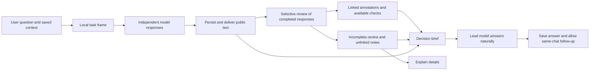

# Council 1.06: answering first, review alongside it

Plan date: October 23, 2026. **Status: software implemented and validated; see the checklist for the B08 test-order exception and unperformed human quality evaluation.**

An urgent [non-interrupting delivery bridge](../docs/operations/NON_INTERRUPTING_REVIEW_DELIVERY.md) has been delivered in the existing `reviewed_v3` path: annotation failures can continue to a qualified public synthesis, unsupported recheck closures stay unresolved, and incomplete family checks do not discard valid assessments. This is not the full two-commit durability/state/migration architecture below. Remaining checklist items are still future work.

This increment builds on the current Council, the 1.01–1.03 review foundations, the 1.05 research/accounting work, and admission policy `council-admission/4`. It does not revert those capabilities or replace the application with another agent framework. The product remains **Council**, with Simple and Explain views of one workflow. Engineering version numbers stay out of the interface.

Execution tasks and release evidence are tracked in the [1.06 implementation checklist](12_ANSWER_FIRST_COUNCIL_1.06_CHECKLIST.md). The operations record and acceptance map distinguish implemented behavior, validation gates and the recorded test-order exception. Independent human quality evaluation remains unperformed.

## 1. Golden rule and intended result

**The harness must help models answer; ordinary review problems must never interrupt answer generation, discard an answer, require a format retry, or force a new conversation.**

Models complete their public responses. The application saves and delivers those responses independently of whether an internal claim index, reviewer annotation, equation descriptor or synthesis attachment is complete. Review can finish with warnings. Missing review is not a reason to withhold a useful answer, and is never presented as completed verification.

The distinction is between delivering an answer and certifying an interpretation of it. The first must not depend on the second. A genuinely unknown reference must not enter the trusted claim ledger, but the model's public response remains visible and the council can continue with that part explicitly unreviewed.

The user can still Pause or Stop. The application must still enforce authorized spending, preserve unknown charge holds, protect credentials, respect the actual provider/context limits and refuse an unauthorized external action. Those boundaries control actions and new dispatch. They do not justify hiding an answer that has already been received. Provider failure and an unrecoverable storage failure cannot be promised away.

The useful product outcome is a calm, inspectable council that can survive several turns, research when enabled, challenge consequential mistakes, preserve unconventional ideas, and give a readable recommendation or comparison without turning the user into its schema debugger.

## 2. What the repository actually has

| Existing capability | Keep | Actual remaining gap |
| --- | --- | --- |
| Token Factory public streaming and artifacts | Public text, model identity, timing, usage, receipts and saved partials; private reasoning text is not retained. | A received reply can still fail before becoming a normal chat message because review admission precedes `message()` in `council_chat.py`. |
| Admission policy 4 | Wrapped/repeated JSON handling, structured prose, optional-null normalization, supplemental notes, local recovery and exact raw receipts. | This is still a list of tolerated representations. An unanticipated validation error can still escape to the executor and mark the whole chat failed. |
| Current review engine | Independent openings, exact source spans, claim dependencies, family grouping, scrutiny, author repair, recheck and optional focused exchange. | Metadata admission and progression remain too tightly coupled; malformed nonessential metadata can prevent the next useful stage. |
| Publication policy | Objection resolution, evidence, conditions, residual risks and dependency effects are already distinguished. | Presentation can still be dominated by eligibility gates, ledger wording or incomplete annotations instead of the requested answer. |
| Shared research library | Saved documents, versioned passages, bounded Tavily research, source tools, cache-aware context packs and source attribution. | Research failure needs the same explicit continue-with-available-information policy as review failure. |
| Multi-turn/context controls | Same-chat follow-ups, targeted review, 262,144-token shared context, compaction, thinking selection and receipts. | Degraded review states need first-class scheduling and migration support rather than operator-only recovery. |
| Accounting | Actual/estimated/unknown usage, cache categories where reported, pre-dispatch reservations and global spending authority. | Review must reserve useful finishing capacity before consuming optional effort; degraded stages must not cause hidden retries or double charges. |
| Simple / Explain | One workflow, readable math, copy controls, source and usage inspection. | The default view still exposes technical admission failures as interruptions. Review warnings should sit beside a delivered answer. |

Evidence already available: 143 backend checks passed for the recent prose/admission work, with an additional 13-check targeted run. These prove tested software behavior, not end-to-end live reliability or independent answer quality. See [prose recovery evidence](../docs/validation/review-prose-live-recovery.json). Historical test counts are not acceptance evidence for 1.06.

Current Token Factory defaults are **Nemotron Super as lead, Reflection Beam, and DeepSeek**. Lightning stays optional; GLM remains historical. The shared context remains 262,144 tokens; Balanced retains the 4K advisory reasoning target and model-specific effort controls. No independent hard thinking cap, guaranteed sub-minute completion, paid GPU, new paid service or new account is introduced.

## 3. Assessment of all 22 proposal sections

The attachment is a design proposal to evaluate, not a set of commands to execute verbatim.

| Proposal | Decision for 1.06 | Repository-specific treatment |
| --- | --- | --- |
| 1. Non-intrusive sidecar | **Adopt as the principal change** | Separate durable public replies from optional structured review. Sidecar completion cannot cancel an active stream or make a completed answer disappear. |
| 2. Pre-debate framing auditor | **Adapt** | Build a lightweight local task frame from the user's explicit question, constraints and requested output. No mandatory extra model call before openings; no automatic narrowing. Disputed premises are questions to examine, not rewritten instructions. |
| 3. Independent openings | **Retain and simplify** | Same frozen user/source snapshot; no peer answers, rankings or critic notes before the opening barrier. The proposed opening checklist is guidance, not required fields, a word cap or a rejection rule. |
| 4. Atomic extraction | **Retain and make partial admission possible** | Preserve exact spans and original prose. Invalid individual annotations stay unlinked. Review a bounded material subset and disclose omissions rather than demanding exhaustive extraction. |
| 5. Claim classification | **Adapt** | Preserve the existing reasoning-kind/properties distinction. Additional descriptive tags are optional open labels; an unfamiliar tag cannot stop answering or invent an evidence requirement. |
| 6. Deduplication and families | **Retain** | Group equivalent mechanisms while preserving each source and implementation difference. Do not merge original assertions or treat agreement as independent support. |
| 7. Claim graph | **Retain and improve** | Reuse current dependency/revision tracking. Unresolved or invalid edges remain unknown; propagate caution to dependent recommendations, without suppressing the surrounding answer. |
| 8. Six parallel auditors | **Adapt; defer the agent fan-out** | Use these as task-selected lenses in the existing scrutiny call and existing bounded local checks. Do not add six paid model calls, six runtimes or uncontrolled concurrency. |
| 9. Dedicated falsifier | **Adopt within the existing critic role** | Ask for the strongest relevant attack, including the case where it fails. Do not reward finding a defect, force an objection, or let the critic promote its own competing proposal. |
| 10. Priority formula | **Adapt** | Use explainable ordinal impact/uncertainty/dependency signals. The proposed product of scores is a scheduling heuristic, not a calibrated probability or a factual ranking. |
| 11. Cross-examination | **Retain, selective** | Group unresolved decision-changing questions into existing author responses/focused exchange. Question counts are cost targets, not reasons to reject longer valid prose. |
| 12. One repair round | **Adopt as the default target** | Preserve original/revised content and withdrawal history. Allow additional user-requested turns; do not end a chat because the default repair round finished. |
| 13. Recheck adjudication | **Retain and refine** | Compare an exact objection with the actual response. Keep partial resolution, new issues, ordinary risk and missing evidence separate. |
| 14. Procedural versus epistemic status | **Retain; simplify terminology** | Reuse the current separation. Add a readable evidence summary where useful. Do not let a model assign itself trusted `ESTABLISHED`, `VERIFIED` or experimental authority. |
| 15. Materiality filter | **Adopt with a changed consequence** | Major issues affect the recommendation and optional scrutiny. Minor/moderate issues are notes. Reject the proposal's requirement that all major/critical issues must be resolved before any synthesis: synthesize an honest conditional answer or comparison instead. |
| 16. Stop conditions | **Adapt** | Finish unnecessary review and proceed to an answer. Record the next useful test or missing evidence. A stop reason must not cancel a model mid-response, erase the conversation, or mean that a scientific question is proved settled. |
| 17. Common comparison model | **Adopt, task-specific** | Compare alternatives under the same user criteria and boundaries. Do not subtract incomparable units or invent risk penalties, utility weights, operating costs or measurements. |
| 18. Judge selects | **Adopt the decision brief; no extra mandatory judge call** | Reuse recheck/policy plus the lead synthesizer. Give a preferred option when justified, or distinguish theoretical/practical/speculative choices and what would reverse the choice. |
| 19. Constrained synthesizer | **Adapt substantially** | Answer naturally using actual public replies and available sources. Audited, conditional and unreviewed ideas can appear with accurate labels. Reject a whitelist that makes missing metadata censor the final answer. The nine suggested sections are optional, not a universal template. |
| 20. Non-interruption | **Adopt as an acceptance invariant** | Enforce in persistence, scheduler, stream cancellation, local tools and UI—not merely in prompts or a growing normalizer. |
| 21. Anti-steering | **Adopt** | No preferred mechanisms, early rankings or novelty penalties. Distinguish conceptual contradiction, engineering difficulty and absent evidence. Preserve promising speculative alternatives honestly. |
| 22. Regression/quality evaluation | **Adopt and extend** | Add non-interruption and multi-turn fault injection to existing protocol tests. Evaluate usefulness, false rejection, attribution and novelty with held-out human labels; do not advertise semantic gains from fixture passes. |

The proposed Normal/Deep distinction becomes adaptive internal review allocation, not another user-facing protocol/version selector. Existing **Thinking** remains reasoning effort, not the number of auditors. Extra paid depth requires an explicit bounded execution plan within the user's existing authorization; the question merely sounding scientific does not authorize extra calls.

## 4. Architecture

### 4.1 Answer delivery and annotation are separate commitments

1. The provider request remains governed by existing authorization, context and financial reservations.
2. Public text is persisted incrementally or as recoverable bounded chunks, with sequence/replay protection. Reasoning activity/counts may be observed; private reasoning text is not saved or exposed.
3. Provider completion stores its public reply and receipt before review interpretation. A structured review response can remain an internal raw artifact; public debate/final prose is independently deliverable.
4. A separate savepoint attempts annotation parsing and linking. Its failure creates a review warning, not a failed answer or a failed chat.
5. The scheduler records the stage as completed, partially reviewed, degraded or intentionally skipped. It does not infer completion solely from the presence of a valid ledger/message combination.
6. Subsequent stages use the available public replies and valid records. They are told which interpretations are missing; they never receive fabricated claims, sources or successful checks as substitutes.

Creating more formatting exceptions remains useful but is not the architecture. The answer path must survive a previously unseen review representation or an exception in the sidecar.

### 4.2 State and persistence additions

| Record | Required purpose |
| --- | --- |
| Public answer/message | Actual seat/model, call, cycle/turn, public text/chunk sequence, content hash, complete/partial state, source snapshot and timing. It exists independently of review admission. |
| Stage result | Current input-context hash, call/receipt, stage, terminal progression state, annotation coverage and warning IDs. Terminal degraded/skipped states prevent retry loops. |
| Review warning | Cause/category, affected annotation paths, original values/artifact link, materiality and user-readable consequence. It grants no evidence or permissions. |
| Linked annotation | Valid source/revision/author linkage and origin, with independent valid/partial/unlinked status. No unknown ID is manufactured to satisfy a schema. |
| Decision brief | User objective/criteria, alternatives, preferred option if justified, assumptions, ranking-reversal conditions, material unresolved issues and next useful action. Missing evidence stays explicit. |

Use additive SQLite records and versioned descriptors, with idempotent keys based on cycle, turn, attempt and receipt. Keep execution state, review coverage and claim support separate. Do not label the full chat `failed` because `review_state` is incomplete. Do not claim complete review because generation completed.

### 4.3 Failure behavior

| Event | Answer delivery | Review / next action |
| --- | --- | --- |
| Lists, objects, optional nulls, extra notes, enum presentation differences, repeated identical JSON | Preserve public content. | Normalize locally and continue; retain exact originals and warning details. |
| Non-JSON or otherwise unusable review metadata | Preserve readable model prose and raw receipt. | Mark that stage degraded. Use a bounded public-source packet or skip dependent metadata-only work and proceed to synthesis. No format-repair model call or Resume prompt. |
| Some invalid source/revision/author links | Preserve the public explanation. | Quarantine invalid annotations; admit independent valid records atomically. Leave related claims/issues unreviewed or unresolved. Never use the invalid linkage as support. |
| Missing objections or unsupported recheck closure | Keep the author's response. | Keep missing issues open and continue with appropriate qualifications. Do not silently resolve them, restart the whole round or demand perfect coverage before answering. |
| Local calculator cannot represent a unit/expression | Keep the proposal/derivation. | Check is unavailable or unknown; not a proof, not a chat failure. |
| Search/fetch quota, timeout or missing document | Keep existing answers and sources. | Return a typed unavailable result at the model's requested tool boundary; let it answer from available information. No fabricated citation or repeated identical fetch. |
| Material contradiction or unsupported decisive premise | Finish the active response. | Group criticism between turns; qualify or change the recommendation, or give a comparison/next test. A scientific disagreement is not a transport error. |
| Model/provider genuinely fails or returns no public answer | Preserve other replies and any partial text/usage. | Mark that seat unavailable/partial and continue with remaining material if authorized and affordable. Never invent its answer or automatically replay an ambiguous billed request. |
| Shared credit, permission or integrity boundary prevents another request | Preserve and deliver all completed text. | Stop only the unsafe/new action. Offer the available partial result and the actual reason; retain all financial holds. Do not hide this boundary as a cosmetic warning. |
| User Pause/Stop | Follow the user's control. | Pause blocks new dispatch while preserving an in-flight result; Stop may terminate it as explicitly requested. Review code cannot invoke those controls on the user's behalf over formatting. |

A degraded extraction can produce `unreviewed public source spans`, not fake atomic claims. If the next stage requires data that is not available, the coordinator either uses a truthful public-text variant of that already planned stage or skips it and reaches synthesis. Which branch occurred is saved. This must have one finite transition, not “retry until metadata appears.”

## 5. Concrete workflow and cost envelope

### Default workflow

1. **Local task frame, zero model calls.** Retain the original question and explicit constraints verbatim; derive only an index of requested deliverables. Each model may independently examine disputed premises. Avoid a mandatory framing bottleneck.
2. **Independent openings, one call per selected model.** Use the frozen common evidence revision, lightweight guidance and existing thinking controls. Do not inject peer critique, rankings or later discoveries into an unfinished answer.
3. **Post-response extraction, up to one existing call.** Index material claims/families with omissions disclosed. Do not cancel or retroactively reject an opening if extraction is incomplete.
4. **Selective scrutiny, up to one existing call.** Apply only relevant logic, accounting, provenance, implementation and test-validity lenses. The falsifier can conclude that an attack failed. No six-model audit fan-out.
5. **Author responses, at most the existing one turn per author by default.** Group consequential objections; keep ordinary risk as a note. Uncontested authors may be skipped with a recorded reason. Preserve original/revised claims and public dissent.
6. **Recheck, up to one existing call where useful.** Compare exact objections and responses; distinguish resolution from truth and external support. Repeated objections without new information lead to synthesis, not another loop.
7. **Lead synthesis, one existing call when feasible.** Prefer natural Markdown, a direct response and task-appropriate structure. Use a decision brief; do not require every scientific idea to have passed a complete ledger to be mentioned conditionally.

For N participants, the normal ceiling remains the existing **2N + 4 successful calls**: 10 with three models, 12 with four. Adaptive skipping may use fewer. No extra judge, framer or six auditors is inserted by default. Retain the existing 20-attempt request window and bounded research/focused-exchange accounting; this is not a lifetime limit on the chat. Optional work must fit both the attempt plan and money reservations.

Keep the **$24 aggregate existing-credit cap and $0 additional-payment authority**. Before optional effort, compute a conservative feasible finishing reservation using the existing price/bounds machinery and an actual bounded final-context plan. Do not introduce another arbitrary $0.25 conversation allowance or present a hold as money already spent. If a full final request cannot be funded, deliver existing responses with an explicit partial-result status rather than overdrawing or silently shrinking an active response.

The 4K thinking setting remains advisory and separate in usage displays. No client timer or token counter cuts a healthy response because it exceeded a soft target. The provider still has combined output/context limits and actual transport failure modes; this plan cannot guarantee unlimited output or provider latency. Reuse source versions/cache prefixes without claiming a cache hit unless the provider reports it.

## 6. Review that helps the decision

### Framing and comparison

Keep the user's requested goal, alternatives, constraints and comparison criteria. Expose ambiguous boundaries as assumptions rather than silently solving a different question. Do not hard-code solar physics, memory-wall experiments, a specific utility function or a single universal “net value” equation.

Compare like with like: theoretical versus practical benefit, incremental versus total resources, and ideal versus measured results must have explicit boundaries. Missing values are unknown. A constraint that comes from the user outranks a model's preferred criterion.

### Materiality and scrutiny

Use four descriptive priorities: critical, major, moderate and minor. Record why an issue could change the decision. Those are model/tool/human assessments with visible origins, not a claim of calibrated certainty.

Prioritize an issue when it affects the requested output, a decisive quantitative result, a dependency used by several alternatives, or a practical feasibility constraint. Group duplicates by target and rationale. Do not criticize every sentence, reject novelty for being unfamiliar, demand experiments for a logical claim, or turn an acknowledged limitation into a new falsification.

A critical issue can prevent a justified recommendation; it cannot prevent the user receiving an answer explaining that situation. An unresolved issue should affect the wording/ranking, not suppress unrelated valid work.

### Evidence and judgment

Retain source distinctions: user-supplied premise, model interpretation, derivation, local declared-input calculation, retrieved source, externally assessed support, and actual executed result. A citation string or multiple models agreeing never becomes verified evidence. A linked local calculation checks only its declared inputs and capability.

Keep procedural resolution, available evidence, residual risk and applicability limits separate. A response can satisfy an objection without establishing the claim. Conversely, incomplete external evidence does not justify pretending that a conditional proposal is forbidden to discuss.

The decision brief can distinguish the best theoretical option, the most practical option under the stated constraints, a promising speculative alternative, and the next test most likely to change the ranking. If a winner is unjustified, provide the strongest useful comparison and smallest missing observation. No forced winner or majority voting.

### Synthesis and stopping

End review at natural turn boundaries when there is no useful material dispute left, uncertainty requires evidence/calculation/implementation, or arguments repeat without new information. Record the reason as a procedural stopping decision. Do not imply a theorem is proved because a review budget ended.

The final response should answer first, explain the choice, state the few decisive conditions, and identify the next useful action. Keep alternatives and speculation when they help the user. Full ledgers, technical statuses and JSON belong in Explain/export. Never replace the requested answer with only a compliance notice or ledger.

## 7. Integration boundaries

| Area | Implementation direction |
| --- | --- |
| `council_chat.py`, `executor.py`, `council_runtime.py` | Persist public results before annotation; use explicit stage-result progression; isolate sidecar exceptions; prevent duplicate work and hidden retry loops. |
| `provider.py`, `token_factory_stream.py`, `research_execution.py` | Preserve complete/partial public output, timings and receipts. Keep model-requested tool boundaries valid; review cannot cancel a healthy stream. No private reasoning storage. |
| `review_admission.py`, `review_json.py`, `review_reply_restore.py` | Retain tolerant normalization; add record-level quarantine and machine-readable review warnings; support automatic local reconciliation of unchanged completed receipts without a paid repair call. |
| Current review/contract/policy modules | Add an internally versioned answer-first engine/policy. Reuse source/revision/calculation validators without treating their failure as rejection of the public answer. Do not add another product mode selector. |
| `review_audits.py`, `review_calculations.py`, `review_provenance.py` | Keep bounded capabilities and origin integrity. Unsupported checks return unknown. Materiality affects attention, not whether an answer may exist. |
| Research/library/context modules | Same shared source versions; frozen opening exposure; reuse exact passages. Compaction preserves user constraints, material objections, dissent and source anchors. |
| `budget.py`, accounting/generation controls | Preserve all settlements/unknown holds; account for skipped/attempted stages accurately; reserve feasible finishing work before optional review. |
| `CouncilChat.tsx`, `CouncilExperience.tsx`, `CouncilBody.tsx`, review/source/usage panels | Answer remains visible. Simple shows a small relevant note for incomplete review; Explain shows cause, coverage, raw receipt and originals. No red error banner/Resume button for a formatting warning. |
| Review/source exports and replay | Separate original text, annotations, actual checks and warnings. Mixed historical/current chats reproduce their recorded status without retroactive certification. |

Suggested internal versions: protocol `reviewed_v4`, policy `generic-publication-v4`, and a versioned execution/annotation descriptor. These are engineering identifiers only. Freeze exact names and compatibility tests in WP0 before implementation. Do not reinterpret old v1/v2/v3 publications through the new policy.

## 8. Delivery roadmap

| Work package | Deliverable | Dependency / acceptance focus |
| --- | --- | --- |
| WP0 — Baseline and contracts | Frozen current fixtures, failure taxonomy, state model, migration/replay design and golden-rule tests. | No production behavior change. |
| WP1 — Durable answer delivery | Public-message/receipt persistence independent of annotation; healthy streams survive sidecar faults. | WP0; prove durability/replay and exact original content. |
| WP2 — Degraded review progression | Per-record quarantine, partial review states, finite fallback branches and automatic local receipt reconciliation. | WP1; cosmetic failures require neither Resume nor another inference call. |
| WP3 — Useful, selective deliberation | Lightweight framing, materiality, existing critic lenses, grouped repairs and stopping rules. | WP2; preserve independent openings and novelty. |
| WP4 — Decision and natural synthesis | Decision brief, conditional/unreviewed-source handling, human-readable synthesis and conservative provenance. | WP2–3; answer still delivered when review is unavailable. |
| WP5 — Multi-turn and research resilience | Long-chat stage state, source/version/compaction handling, tool-unavailable continuation, finishing reservations. | WP1–4; no reset of history or spending. |
| WP6 — Simple/Explain presentation | Quiet warnings, visible answers, clear partial states, optional review details and replay-safe copy/export. | WP2 and WP4; no extra API calls from UI inspection. |
| WP7 — Proof and hackathon package | Fault-injection demo, replayable evidence, quality evaluation plan and bounded live compatibility record. | All prior packages. |

Ship WP1–2 before expanding review intelligence. The repeated admission incidents show that more auditors on the existing failure path would amplify the wrong problem.

## 9. Acceptance and honest evidence

The [checklist](12_ANSWER_FIRST_COUNCIL_1.06_CHECKLIST.md) defines task IDs and scenarios A01–A24. Essential release conditions are:

- Zero harness-initiated cancellation of healthy streams in the seeded review-fault suite.
- Every received public reply is recoverable with original attribution, even if annotation completely fails.
- Seeded cosmetic failures complete a multi-turn council without a format-repair API call, a Resume requirement or a new-chat instruction.
- Invalid annotations never become valid evidence/claim revisions merely because delivery continues.
- No extra default audit/judge calls; all skipped and attempted work stays visible in cumulative usage.
- Budget and unknown-charge invariants survive retries, restart, user Pause/Stop and concurrent UI actions.
- Three explicit follow-ups retain prior text, source history, costs, unresolved material objections and selected model overrides.
- The final answer is readable and addresses the requested deliverable; missing review produces qualifications rather than an empty result.

Record measured first-public-text latency, complete-response time, controller overhead, review token share, actual attempts, warnings, stops and known/unknown cost. A “no interruption” claim concerns application behavior; it is not a provider uptime or model-speed guarantee. Set performance targets against a frozen fixture after collecting the baseline, and report regressions rather than inventing speedup percentages.

For quality, retain held-out tasks across multiple domains and human-labeled dimensional/arithmetic errors, hidden costs, false citations, causal overclaims, duplicate families, ordinary residual risk, valid unconventional ideas and misleading majority agreement. Report material-error recall, false rejection, attribution, novelty preservation, usefulness and synthesis fidelity with denominators, failures and unlabelled cases. Do not use those labels to tune the same held-out set.

## 10. Hackathon delivery and deliberate exclusions

Prioritize a short, credible demonstration: one question, independent models through Token Factory including the selected NVIDIA lead, a focused disagreement, a useful conclusion, sources and actual token/cost accounting, then a same-chat follow-up. Show an injected formatting fault continuing normally. Label that fault injection as synthetic; keep genuine provider receipts separate.

Prepare one replayable offline demo plus a separately identified real compatibility run when the user chooses to test within the existing cap. Verify the competition's current submission/judging and technology-use requirements before submission rather than asserting that a feature guarantees a win. Use the already selected hackathon track and published application evidence; no separate GPU or LangSmith subscription is needed for this plan.

Defer six independent paid auditors, a new multi-agent framework, automatic web research on every message, unbounded retries/debate, automatic paid caching warmers and domain-specific scientific certification. Reject premature framing/ranking, hard editorial gates, model-granted verification, compulsory nine-section answers, and a judge whitelist that hides useful model output. These add friction, unearned authority or expense without addressing the demonstrated product failure.

**Definition of done:** Council keeps answering through ordinary harness failures, exposes honest review limits, preserves the conversation and money trail, and delivers an inspectable result. No blanket guarantee is made for provider failure, missing authorization, storage failure or unsupported scientific claims.
